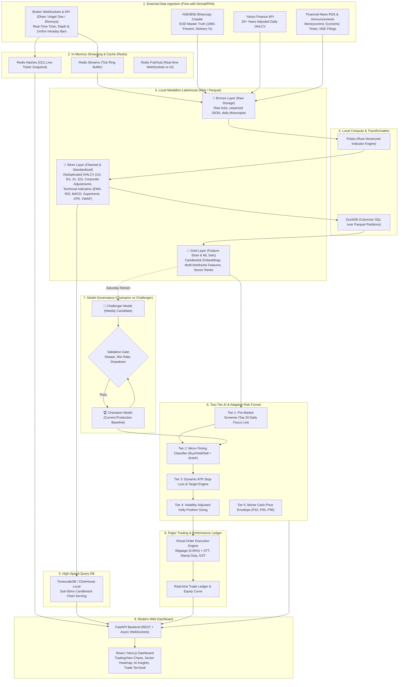
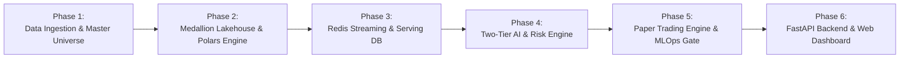

# MarketIntel: Master Project Plan & Complete System Design Specification
## Institutional-Grade Indian Stock Market Analytics & Autonomous AI Trading Platform

---

## 1. System Vision & Core Objectives
**MarketIntel** is a local-first, zero-cloud-cost market intelligence and algorithmic paper-trading platform designed specifically for the Indian Equity Markets (NSE & BSE).

### Core Pillars:
1. **Dual-Exchange Market Coverage**: Master mapping for all ~2,250 NSE and ~5,400 BSE listed equities using ISIN as the global entity key.
2. **Local Medallion Lakehouse**: Zero-cloud-cost data lakehouse on local disk with **Bronze (Raw)**, **Silver (Cleaned & Indicators)**, and **Gold (Features & ML Datasets)** layers powered by **Polars** and **DuckDB**.
3. **High-Throughput In-Memory Caching**: **Redis Hashes** for $O(1)$ live market quotes, **Redis Streams** for tick buffering, and **Redis Pub/Sub** for frontend WebSockets.
4. **Hierarchical AI Pipeline**:
   - **Tier 1 (Universe Screener)**: Pre-market ranking narrowing 2,000+ stocks down to the Top 20 Focus Stocks of the day.
   - **Tier 2 (Micro-Timing ML)**: Directional classifier outputting calibrated probabilities (**Buy / Hold / Sell** with confidence scores and SHAP explainability).
   - **Tier 3 (Adaptive Risk & Execution)**: Dynamic ATR trailing stop-loss, volatility-adjusted position sizing, and staged profit exits.
   - **Tier 4 (Price Corridor Engine)**: Quantile regression & Monte Carlo probabilistic envelopes (P10, P50, P90).
5. **Champion-vs-Challenger MLOps Governance**:
   - Fixed Saturday 02:00 AM retraining schedule.
   - Incremental warm-start model updates on delta features (never re-processing historical data).
   - Automated backtest benchmark gate: Challenger promoted to Champion only if it beats the baseline on Sharpe ratio, precision, and drawdown.
6. **Modern Web Terminal**: Real-time TradingView charting, sector heatmaps, stock search, AI Insights breakdown, and automated paper-trading ledger.

---

## 2. End-to-End System Architecture



---

## 3. Detailed Component Specifications

### 3.1 Dual-Exchange Master Security Universe
* **Universal Identifier**: `ISIN` (International Securities Identification Number).
* **Data Fields**:
  - `isin`: Universal primary key.
  - `nse_symbol`: Official NSE ticker (e.g., `RELIANCE`).
  - `bse_code`: Official BSE 6-digit scrip code (e.g., `500325`).
  - `bse_id`: BSE alphanumeric scrip ID (e.g., `RELIANCE`).
  - `company_name`: Full legal company name.
  - `sector`: SEBI/NSE macro-economic sector (e.g., `Financial Services`, `IT`, `Oil & Gas`).
  - `industry`: Sub-industry category.
  - `market_cap_tier`: `LargeCap` (Top 100), `MidCap` (101-250), `SmallCap` (251-500), `MicroCap` (500+).
  - `primary_exchange`: `NSE` preferred; automatically falls back to `BSE` for exclusive listings.

---

### 3.2 Data Ingestion & Storage Architecture

#### Storage Partitioning Scheme (Parquet / Delta Lake):
```
d:\PROJECT\MarketIntel\data\lakehouse\
├── bronze\
│   ├── bhavcopy\year=YYYY\month=MM\bhav_YYYYMMDD.parquet
│   ├── broker_ticks\exchange=NSE\date=YYYYMMDD\ticks_HH.parquet
│   └── news\year=YYYY\month=MM\news.jsonl
├── silver\
│   ├── ohlcv_1d\exchange=NSE\symbol=RELIANCE\data.parquet
│   ├── ohlcv_1m\exchange=NSE\symbol=RELIANCE\year=YYYY\month=MM\data.parquet
│   └── ohlcv_5m\exchange=NSE\symbol=RELIANCE\year=YYYY\month=MM\data.parquet
└── gold\
    ├── features_daily\symbol=RELIANCE\features.parquet
    ├── features_intraday_5m\symbol=RELIANCE\year=YYYY\features.parquet
    └── sector_aggregates\date=YYYYMMDD\sector_summary.parquet
```

#### Calculated Silver Indicators (Computed via Rust-Vectorized Polars):
* **Trend & Momentum**: EMA (9, 21, 50, 200), SMA (20, 50), Supertrend (10, 3), MACD (12, 26, 9), RSI (14), ADX (14).
* **Volatility & Range**: Average True Range (ATR 14), Bollinger Bands (20, 2), Keltner Channels.
* **Volume & Institutional Footprint**: Volume Weighted Average Price (VWAP), Volume 20 SMA, On-Balance Volume (OBV), Delivery % Ratio vs 20-day average.
* **Candlestick Structure Vectors**: Upper shadow ratio, body ratio, lower shadow ratio, gap percentage vs ATR.

---

### 3.3 Dual-Model AI Intelligence & Quantitative Trading Pipeline

The AI system is structured into two specialized, decoupled model pipelines:

#### Model A: Short-Term Micro-Timing & Intraday Engine (1m / 5m)
* **Goal**: High-probability intraday breakouts, scalps, and 1–3 day momentum swings.
* **Features**: Real-time VWAP deviation, 5-minute Supertrend (10, 3) flips, 9/21 EMA slope, candlestick anatomy vectors (wicks, body ratios), and intraday RSI divergence.
* **Actionable Output**: Calibrated probabilities ($\mathcal{P}(\text{Buy}), \mathcal{P}(\text{Hold}), \mathcal{P}(\text{Sell})$), intraday entry price, dynamic ATR trailing stop-loss, and rapid 1.5R partial profit targets.

#### Model B: Long-Term Positional & Swing Investment Engine (Daily / Weekly)
* **Goal**: Positional swings (1–4 weeks) and multi-month investment allocations (1–12 months).
* **Features**: Daily 50/200 EMA golden cross, multi-week Sector Relative Strength vs NIFTY, institutional Delivery Volume % accumulation ($>1.5\sigma$), and Volatility Contraction Patterns (VCP).
* **Actionable Output**: Positional trend rating, wide swing stop-loss ($2.5 \times \text{ATR}_{\text{Daily}}$), 3R–5R multi-month profit targets, and 1-year Monte Carlo price corridor envelopes (P10 Downside Floor, P50 Baseline, P90 Bullish Ceiling).

#### Tier 3: Adaptive Risk & Exit Rules
* **Initial Stop-Loss**: Placed dynamically at:
  $$\text{SL} = \text{Entry Price} - (1.5 \times \text{ATR}_{14})$$
* **Risk Unit ($R$)**: $R = \text{Entry Price} - \text{SL}$.
* **Target 1**: Placed at $+1.5R$. Upon fill, **50% of the position is closed**, and the stop-loss on the remaining position is moved to **Breakeven** ($\text{Entry} + \text{Slippage}$).
* **Target 2 & Trailing**: Remaining 50% is trailed using dynamic Chandelier/Supertrend bands until a structural reversal occurs.

#### Tier 4: Volatility-Adjusted Position Sizing
* **Capital Preservation Rule**: Maximum risk per trade is strictly capped at $1.0\%$ of total virtual portfolio equity:
  $$\text{Trade Quantity} = \left\lfloor \frac{\text{Portfolio Capital} \times 0.01}{|\text{Entry Price} - \text{Dynamic SL}|} \right\rfloor$$

#### Tier 5: Probabilistic Price Corridor (Multi-Horizon Forecast)
* Avoids naive point estimates. Uses **Quantile Regression & Monte Carlo Drift**:
  - **P90 (Bullish Ceiling)**: 90th percentile optimistic boundary.
  - **P50 (Median Trajectory)**: Most probable baseline trend.
  - **P10 (Downside Floor)**: 10th percentile downside risk support.

---

### 3.4 Champion vs. Challenger MLOps Governance Framework

1. **Retraining Cadence**: Fixed every **Saturday at 02:00 AM IST**.
2. **Delta-Only Ingestion**:
   - Only the latest 5 days of candles are calculated and appended to the Gold feature store.
   - Old feature partitions are never recomputed.
3. **Warm Retraining**:
   - LightGBM `init_model` loads existing **Champion** weights.
   - Boosts additional residual trees on the latest delta features, completing in seconds.
4. **Validation Gate (Head-to-Head Benchmark)**:
   - Both **Champion** and **Challenger** run a backtest on an out-of-sample test window.
   - **Promotion Condition**: Challenger must achieve:
     - Sharpe Ratio $\ge$ Champion.
     - Directional Win-Rate $\ge 55\%$.
     - Maximum Drawdown $\le$ Champion.
   - If conditions pass: Challenger is promoted to **Champion (Baseline)** for Monday.
   - If conditions fail: Challenger is discarded, and the existing Champion stays active.

---

### 3.5 High-Speed In-Memory & Serving Layer

* **Redis Key Namespace Architecture**:
  - `quote:{exchange}:{symbol}`: Hash storing `ltp`, `open`, `high`, `low`, `close`, `vwap`, `volume`, `pct_change`, `updated_at`.
  - `stream:ticks:{exchange}`: Append-only tick stream with 100,000 tick ring buffer.
  - `pubsub:live_quotes`: Broadcast channel to active browser WebSockets.
* **Serving Database (TimescaleDB / ClickHouse Local)**:
  - Stores hypertable of 1m, 5m, and 1D candles for immediate querying by frontend charts.
  - Pre-aggregated continuous views for sub-30ms chart loads.

---

### 3.6 Frontend Web Application Blueprint

1. **Dashboard Home**:
   - Real-time Market Breadth (Advance/Decline, NIFTY 50, BANK NIFTY, INDIA VIX).
   - Sector Performance Treemap / Heatmap.
   - AI Top Screener Ticker Cards (Top Momentum, Volume Breakouts).
2. **Terminal & Technical Workspace**:
   - Universal Stock Search with auto-completion across NSE & BSE.
   - High-performance TradingView Lightweight Charting with multi-timeframe switching (1m, 5m, 1h, 1D).
   - Technical Overlays: EMAs, Bollinger Bands, Supertrend, VWAP, Volume Bars, RSI.
3. **AI Insights Panel**:
   - Probabilistic Gauge: Buy / Hold / Sell with calibrated percentage confidence.
   - Key Market Drivers: SHAP feature breakdown.
   - Actionable Trade Plan: Recommended Entry, Dynamic Stop-Loss, Target 1, Target 2.
   - Multi-horizon Price Corridor (P10, P50, P90).
4. **Paper Trading Terminal**:
   - Live simulated portfolio valuation, open positions, order book.
   - Execution log with simulated slippage and statutory charges.
   - Historical performance analytics: Sharpe Ratio, Win Rate %, Profit Factor, Max Drawdown curve.

---

### 3.7 Single-Click Master Production Launcher (`start_marketintel.bat` & `scripts/launch_system.py`)

A production orchestrator enabling complete, zero-friction local platform startup:
1. **Service Auto-Discovery**: Checks if Redis is running; if not, attempts Docker/service startup with zero-cost fallback to built-in in-memory bus.
2. **Pre-Flight System Check**: Verifies Angel One SmartAPI credentials and lakehouse parquet integrity.
3. **Microservices Boot**: Simultaneously launches FastAPI backend, WebSocket bus, AI inference engines, and Paper Trading simulator.
4. **Browser Auto-Launch**: Automatically opens the user's default browser directly to the interactive TradingView Dashboard.

---

## 4. Phase-by-Phase Implementation Roadmap



### Phase 1: Master Universe & Historical Data Pipeline
- [x] Dual-exchange security master database (ISIN mapping NSE & BSE).
- [ ] Automated Bhavcopy downloader script (2000 – Present EOD archive).
- [ ] Bulk historical downloader using `yfinance` for daily OHLCV backfill.
- [ ] Broker API integration module (DhanHQ / Angel One SmartAPI / Shoonya) for 1-minute historical candles.

### Phase 2: Medallion Lakehouse & Vectorized Feature Engine
- [ ] Local Parquet Lakehouse directory layout (Bronze, Silver, Gold).
- [ ] Polars vectorized technical indicator calculator (EMA, RSI, MACD, Supertrend, ATR, VWAP).
- [ ] Candlestick anatomy vectorization module.
- [ ] DuckDB query layer for partitioned Parquet analytics.

### Phase 3: Real-Time In-Memory Bus & Serving Layer
- [ ] Redis client setup (Hashes for O(1) ticker lookups, Streams for tick buffering, Pub/Sub for WebSockets).
- [ ] TimescaleDB / ClickHouse Local hypertable schema for sub-30ms candlestick queries.
- [ ] Streaming bar aggregator: converts real-time ticks into 1m, 5m, and 1h candles.

### Phase 4: Two-Tier AI Pipeline & Adaptive Risk Engine
- [ ] Tier 1: Pre-market Universe Screener (Sector Relative Strength, Volume Breakouts, VCP).
- [ ] Tier 2: LightGBM / XGBoost Micro-Timing directional classifier.
- [ ] Real-time SHAP explainability generator for UI insights.
- [ ] Dynamic ATR-based Stop-Loss & Target calculator.
- [ ] Volatility-adjusted Kelly position sizing algorithm.
- [ ] Quantile Regression Monte Carlo price corridor generator.

### Phase 5: Autonomous Paper Trading & MLOps Champion/Challenger
- [ ] Simulated Order Matching Engine with 0.05% slippage and Indian statutory tax calculations (STT, GST, Stamp Duty).
- [ ] Paper Trading Ledger and Portfolio Tracker (PnL, Sharpe, Drawdown, Win Rate).
- [ ] Scheduled MLOps orchestrator: Saturday 02:00 AM warm-start retraining.
- [ ] Automated validation gate: Challenger vs. Champion benchmark before baseline promotion.

### Phase 6: FastAPI Backend & Modern Web Dashboard
- [ ] FastAPI REST endpoints & WebSocket server for live quote streaming.
- [ ] Interactive Web Dashboard (React / Next.js):
  - Sector Heatmap & Market Breadth.
  - TradingView Lightweight Charts with technical indicators.
  - AI Insights Tab with gauge meter, SHAP explanations, and trade levels.
  - Active Paper Trading Terminal & Performance Analytics.

