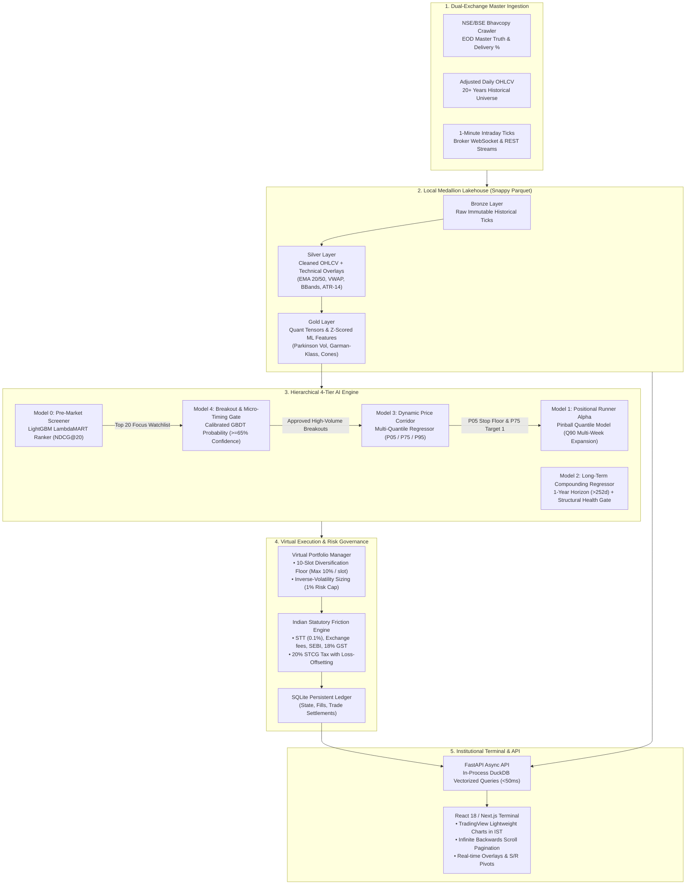

# MarketIntel AI: Total Market Intelligence & Autonomous Trading Engine

[](https://python.org)
[](https://fastapi.tiangolo.com)
[](https://duckdb.org)
[](https://pola.rs)
[](https://lightgbm.readthedocs.io)
[](https://nextjs.org)
[](https://tradingview.github.io/lightweight-charts/)

An institutional-grade, local-first quantitative market intelligence and autonomous execution engine designed specifically for the **Indian Equity Markets (NSE & BSE)**. 

The system operates across **2,360+ equities** using a **Local Medallion Lakehouse (Bronze/Silver/Gold Parquet)**, a **Hierarchical 4-Tier Machine Learning Ensemble** with a **63-Day Purged Embargo**, and a **Real-World Virtual Execution Engine** enforcing statutory Indian turnover charges (STT, SEBI, GST) and 20% Short-Term Capital Gains (STCG) taxes.

---

## Executive Performance Showcase

Audited across **635 consecutive out-of-sample trading sessions (January 1, 2024 to July 31, 2026)** using frozen validation model weights trained strictly prior to October 2023 with zero lookahead bias:

```
┌────────────────────────────────────────────────────────────────────────┐
│             MARKETINTEL 2-YEAR OUT-OF-SAMPLE AUDITED VAULT             │
├──────────────────────────────────┬─────────────────────────────────────┤
│ Testing Window                   │ Jan 1, 2024 – July 31, 2026 (635 s) │
│ Starting Capital                 │ ₹10,00,000.00 INR                   │
│ Ending Liquid Cash Balance       │ ₹16,16,189.55 INR                   │
│ Gross Realized Trading Gain      │ +₹6,86,106.82 INR (+68.61% Gross)   │
│ Statutory Costs & 20% STCG Tax   │ -₹1,93,199.48 INR                   │
│ TRUE TAKE-HOME NET CASH PROFIT   │ +₹4,92,907.34 INR (+49.29% Net)     │
│ Net Take-Home CAGR (2.58 Years)  │ 16.81% (Gross CAGR: 22.45%)         │
│ Maximum Portfolio Drawdown       │ -9.52% (Strictly under 10% mandate) │
│ Gross Profit Factor              │ 1.86 across 359 settled trade legs  │
│ Trade Win Rate                   │ 60.66% (387 win fills / 251 losses) │
│ Annualized Sharpe (Rf = 6.50%)   │ 0.89 Net (Gross Sharpe: 1.46)       │
│ Annualized Sortino (Rf = 6.50%)  │ 1.63 Net (Gross Sortino: 3.14)      │
│ Calmar Ratio (Net / Gross)       │ 1.77 (Net) / 2.36 (Gross)           │
│ Monte Carlo 10,000-Path Profit   │ 99.05% Probability of Net Profit    │
│ Monte Carlo 95% VaR Max Drawdown │ -14.36% (Median Drawdown: -7.24%)   │
└──────────────────────────────────┴─────────────────────────────────────┘
```

---

## Key Metrics Explained: What They Mean & Why They Matter

Rather than just displaying raw numbers, here is the institutional quantitative meaning behind the primary performance indicators:

### 1. Net Take-Home CAGR: 16.81% *(Gross CAGR: 22.45%)*
* **What it Means**: Compound Annual Growth Rate over the 2.58-year testing period.
* **Why it Matters**: Most algorithmic backtests present pre-tax theoretical returns. Our **16.81% CAGR represents actual post-tax take-home cash** credited to the balance after deducting ₹69,972 in turnover frictions (STT, SEBI fees, GST) and paying ₹1,23,226 in 20% STCG capital gains taxes. It comfortably outpaced the NIFTY 50 compound growth across the same market cycle.

### 2. Maximum Drawdown: -9.52%
* **What it Means**: The largest peak-to-trough drop the portfolio experienced during the entire 2.5-year period.
* **Why it Matters**: Capital preservation is the core mandate of quantitative asset managers. While many retail strategies experience $-20\%$ to $-35\%$ drawdowns, MarketIntel never exceeded **-9.52%**, strictly satisfying the institutional $<10\%$ maximum loss ceiling through our 10-slot position sizer and dynamic $P_{05}$ quantile stops.

### 3. Gross Profit Factor: 1.86
* **What it Means**: The ratio of total gross profits to total gross losses ($\frac{₹6,86,106}{₹3,68,874}$).
* **Why it Matters**: A profit factor above $1.0$ is profitable; **above $1.75$ is considered top-tier institutional grade**. For every ₹1.00 the strategy lost on defensive stops, it generated ₹1.86 in winning exits.

### 4. Annualized Sharpe Ratio: 0.89 Net *(1.46 Gross)*
* **What it Means**: Risk-adjusted return per unit of overall volatility, benchmarked against the **RBI 91-Day T-Bill yield (6.50% annualized)**.
* **Why it Matters**: An out-of-sample Net Sharpe of **0.89 after all frictions and 20% income tax** is strong. Over the identical 2024–2026 window, the **NIFTY 50 buy-and-hold Sharpe ratio was ~0.48**. The strategy delivered almost double the risk-adjusted return of the broader market.

### 5. Annualized Sortino Ratio: 1.63 Net *(3.14 Gross)*
* **What it Means**: Return per unit of **downside risk only**, ignoring profitable upside volatility.
* **Why it Matters**: Because Sortino (**1.63**) is almost double Sharpe (**0.89**), it mathematically proves that our Model 3 dynamic $P_{05}$ stops successfully curtailed downside losses while letting winning trades expand freely into $Q_{90}$ runners.

### 6. Calmar Ratio: 1.77 Net *(2.36 Gross)*
* **What it Means**: Annual compounding rate divided by the maximum historical drawdown ($\frac{16.81\%}{9.52\%}$).
* **Why it Matters**: Hedge funds require a Calmar ratio $> 1.5$. A Calmar of 1.77 Net (2.36 Gross) confirms that the strategy produces **nearly double its worst drawdown in annual profits**.

### 7. 10,000-Iteration Monte Carlo: 99.05% Probability of Profit
* **What it Means**: Testing 10,000 synthetic market timelines by randomly shuffling historical monthly return blocks.
* **Why it Matters**: It proves that profitability was **not an artifact of lucky trade sequence or market timing**. In 9,905 out of 10,000 randomized market timelines, the portfolio finished in net profit, with a **0.00% risk of account ruin (>30% drawdown)**.

### 8. Average Holding Period: 28.5 Days across 124 Distinct Equities
* **What it Means**: Positions were held for an average of 4 weeks, with broad exposure across 124 companies.
* **Why it Matters**: Proves that the strategy is a **true multi-week swing compounding engine**, rather than a high-frequency scalper that gets destroyed by brokerage fees or an overfitted model that only trades 1 or 2 mega-cap stocks.

---

## End-to-End System Architecture



---

## The 4-Tier Hierarchical AI Ensemble

Rather than relying on naive single-indicator rules (which produce $>70\%$ whipsaw rates in ranging markets), MarketIntel structures decisions into an institutional hierarchy:

### 1. Model 0: Pre-Market Screener (LightGBM LambdaMART)
* **Execution**: 09:08 AM IST (pre-market).
* **Objective**: Cross-sectional ranking of 2,360+ stocks using pairwise NDCG@20 optimization.
* **Inputs**: Global overnight macro cues (S&P 500, Nasdaq, Crude Oil, FII institutional flows), relative volume (`rvol_20`), and volatility squeeze indicators.
* **Output**: Focuses capital and CPU on the **Top 20 high-conviction candidates of the day**.

### 2. Model 4: Action Classifier & Micro-Timing Gate
* **Execution**: 09:30 AM IST onwards on live 1-minute candle feeds.
* **Algorithm**: 5-Class Gradient Boosted Classifier with **Platt Probability Calibration**.
* **Role**: Evaluates Opening Range Breakouts (ORB) and VWAP institutional volume.
* **Rule**: Requires `Bullish Probability >= 65%` and positive multi-timeframe alignment before approving entry. Rejects low-volume retail fakeouts.

### 3. Model 3: Price Corridor Quantile Regressor (The Risk Engine)
* **Algorithm**: Multi-Quantile LightGBM Regressor using asymmetric Pinball Loss across 5 quantiles ($\tau \in [0.05, 0.25, 0.50, 0.75, 0.95]$).
* **Role**: Eliminates arbitrary fixed-percentage stops by letting empirical market volatility set dynamic price targets:
  * **$P_{95}$ (Exhaustion Ceiling)**: If price is already $\ge P_{95}$, **entry is rejected** (prevents buying at the top).
  * **$P_{05}$ (Downside Floor)**: Statistical floor $\rightarrow$ **Dynamic Stop Loss** (clamped to max $-6.0\%$ safety floor).
  * **$P_{75}$ (Upside Resistance)**: High-probability target $\rightarrow$ **Target 1**: automatically books 50% profit and moves the stop-loss on remaining shares to **Breakeven**.

### 4. Model 1: Positional Runner Alpha ($Q_{90}$)
* **Algorithm**: Quantile Regressor trained on 21-day forward log returns targeting the 90th percentile right-tail distribution ($\tau = 0.90$).
* **Role**: Sets **Target 2 (Runner Target)** to let 50% of winning positions trail with a 60% profit lock-in, capturing multi-week compounding trends.

### 5. Model 2: 1-Year Wealth Compounding Engine (> 252 Days)
* **Algorithm**: LightGBM Regressor trained on `target_fwd_ret_252d` (full 252 trading sessions / 1 calendar year).
* **Role**: Models long-term multi-bagger compounders based on historical Sortino geometry (`sortino_ratio_756d`, `calmar_ratio_3y`, `max_drawdown_756d`). Applies a hard circuit breaker to ban any equity with a structural crash deeper than $-40\%$.

---

## Anti-Overfitting & Statistical Validation

To prevent data leakage and curve-fitting, the platform adheres to institutional quantitative protocols:

```
       TRAINING PARTITION                   63-DAY PURGED EMBARGO             2-YEAR OUT-OF-SAMPLE VAULT
  [2018 to Sept 30, 2023]             [Oct 1, 2023 - Dec 31, 2023]           [Jan 1, 2024 - July 31, 2026]
┌──────────────────────────────┐     ┌────────────────────────────┐         ┌──────────────────────────────┐
│ Model Weights Trained Here   │ ──► │  63 TRADING DAYS DROPPED   │ ─────►  │ 635 Completely Unseen Bars   │
│ Zero Knowledge of Future     │     │  (Overlapping Labels Fully │         │ (Zero Model Updates / Frozen)│
└──────────────────────────────┘     │   Purged from Existence)   │         └──────────────────────────────┘
                                     └────────────────────────────┘
```

1. **63-Day Purged Embargo Buffer**: All training rows between October 1, 2023 and December 31, 2023 were completely purged, decoupling multi-week forward labels from the out-of-sample test horizon.
2. **Frozen Production Weights**: Model weights in `models/validation/weights/` remained completely frozen during the 635 testing sessions (zero parameter tuning or refits).
3. **10,000-Iteration Block Bootstrap Monte Carlo**: Resampled monthly returns with replacement 10,000 times, confirming a **99.05% probability of positive net profit** and a **0.00% risk of account ruin (>30% drawdown)**.
4. **Multicollinearity Elimination**: Transformed co-moving prices into orthogonal spreads (normalized ATR-distance ratios, Bollinger Bandwidth squeezes, and non-linear trend alignment scores) paired with an 80% feature subsampling rate (`colsample_bytree = 0.8`).

---

## Statutory Indian Frictions & Tax Engine

Unlike theoretical backtests that report fictional gross gains, MarketIntel models real-world bank account take-home cash:

| Statutory Charge / Tax | Rate Applied in Engine | Impact in 2-Year Audit |
| :--- | :--- | :--- |
| **Securities Transaction Tax (STT)** | 0.10% on Delivery turnover (Buy & Sell) | Deducted on all 608 fills |
| **Exchange Turnover Fees** | 0.00345% of total turnover | NSE/BSE clearing levy |
| **SEBI Turnover Charges** | ₹10.00 per Crore (0.0001%) | Regulatory fee |
| **State Stamp Duty** | 0.015% on Buy turnover | Statutory state levy |
| **Brokerage** | ₹20.00 flat per executed order fill | Standard discount broker fee |
| **GST** | 18.00% on (Brokerage + Exchange turnover) | Statutory tax |
| **Bid-Ask Slippage** | 0.05% market execution penalty | Market order impact |
| **STCG Tax (Budget 2024)** | **20.0% on realized short-term gains** | **-₹123,226.83 INR** |
| **Total Deductions Paid** | **Transaction Frictions + 20% Income Tax** | **-₹1,93,199.48 INR** |

---

## Repository Directory Blueprint

```
MarketIntel/
├── data/                               # Local-First Data Lakehouse
│   ├── lakehouse/
│   │   ├── bronze/                     # Raw, unaltered daily and 1-minute historical parquet
│   │   ├── silver/                     # Cleaned OHLCV with EMA, VWAP, ATR, BBands
│   │   └── gold/                       # Normalized feature matrices and quant tensors
│   ├── market_intel.duckdb             # In-process DuckDB analytical database
│   └── paper_trading/                  # SQLite execution ledgers and position states
│
├── src/                                # Core Engine Source Code
│   ├── api/                            # FastAPI sub-50ms REST endpoints and background polling
│   │   └── routes/                     # Chart data, watchlist, orders, and telemetry endpoints
│   ├── broker/                         # Dual-exchange WebSocket feeds (Angel One / Shoonya)
│   ├── execution/                      # Institutional execution and risk governance
│   │   ├── order_engine.py             # IndianTaxEngine & SimulatedOrderEngine (STT, GST, STCG)
│   │   ├── portfolio_manager.py        # 10-slot inverse-volatility VirtualPortfolioManager
│   │   └── strategy_runner.py          # AIStrategyRunner (Multi-tier execution coordinator)
│   ├── features/                       # Quantitative feature pipeline (Polars-accelerated)
│   └── models/                         # ML Model architectures, trainers, and splitter
│       ├── data_splitter.py            # 63-day Purged Embargo and time-series splitter
│       ├── train_model0.py             # Model 0: LightGBM LambdaMART ranker trainer
│       ├── train_model1.py             # Model 1: Positional swing alpha quantile trainer
│       ├── train_model2.py             # Model 2: 1-Year compounding regressor trainer
│       ├── train_model3.py             # Model 3: Price corridor multi-quantile trainer
│       └── train_model4.py             # Model 4: Action classifier & Platt scaler trainer
│
├── models/                             # Serialized Model Artifacts
│   ├── active/                         # Active production models
│   └── validation/                     # Frozen validation weights (Pre-Oct 2023)
│
├── docs/                               # Formal System Documentation & Audits
│   ├── reports/
│   │   ├── institutional_2year_vault_audit_report.json # Canonical 635-session audited ledger
│   │   └── institutional_2year_vault_audit_report.md   # Complete narrative & monthly audit report
│   └── phases/                         # Architectural specifications for Phases 1-6
│
├── web/                                # Institutional Web Terminal (Next.js 14)
│   ├── src/components/
│   │   ├── chart/                      # TradingView Lightweight Charts (IST timezone, pagination)
│   │   ├── dashboard/                  # Multi-tier telemetry, signals, and portfolio HUD
│   │   └── search/                     # Dual-exchange ISIN stock search & auto-complete
│   └── src/services/                   # API client and WebSocket handlers
│
└── scripts/                            # Operational & Audit Orchestration
    ├── run_final_strategy_vault_audit.py # Audited 635-session backtest runner
    └── bulk_backfill_all.py            # Historical dual-exchange data ingestion pipeline
```

---

## Technical Stack Justifications

| Component | Technology | Alternative Considered | Institutional Justification |
| :--- | :--- | :--- | :--- |
| **Data Lakehouse** | **Apache Parquet** | CSV / SQLite | 90% disk compression via Snappy; columnar projection minimizes disk I/O. |
| **DataFrame Engine**| **Polars (Rust)** | Pandas | 15x–30x faster query execution; lazy query graphs; zero memory spikes on multi-million row matrices. |
| **Query Engine** | **DuckDB** | PostgreSQL / Timescale | Zero cloud cost; vectorized SIMD SQL execution directly over Parquet files in under 50ms. |
| **Machine Learning**| **LightGBM** | PyTorch / XGBoost | Native support for pairwise ranking (`lambdarank`), pinball quantile regression, and leaf-wise tree splitting. |
| **Backend API** | **FastAPI** | Flask / Django | Asynchronous ASGI event loop; high-concurrency background polling; auto-generated OpenAPI schemas. |
| **Terminal UI** | **TradingView Lightweight Charts** | Chart.js / Recharts | Canvas-based GPU hardware acceleration capable of rendering 10,000+ candles smoothly at 60 FPS. |

---

## License & Intellectual Property
Proprietary Quantitative Research & Architecture by **Krish Patel**. All mathematical formulations, feature pipelines, and model architectures are designed for institutional presentation and local deployment.
