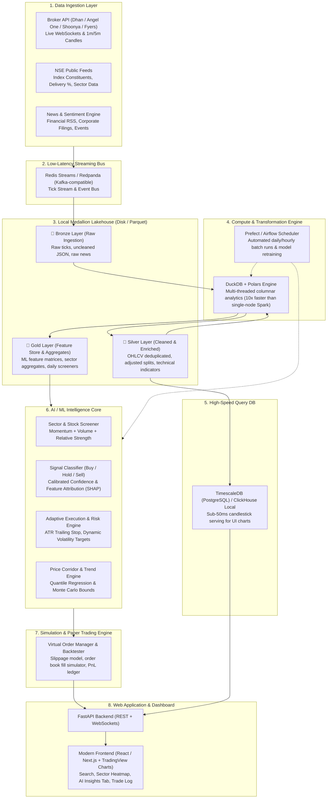

# MarketIntel: High-Performance Indian Stock Market Analytics & AI Trading Engine
## System Architecture & Technical Blueprint

---

### 1. Executive Summary & Philosophy

The objective is to design an institutional-grade, local-first stock market intelligence and automated trading platform tailored for the Indian Equity Markets (NSE/BSE). The platform combines:
- Real-time tick & multi-timeframe candlestick ingestion (1-min, 5-min, 1-hour, 1-day).
- A local **Medallion Lakehouse** architecture (Bronze $\rightarrow$ Silver $\rightarrow$ Gold) for zero-cloud-cost storage.
- An **AI/ML Decision & Adaptive Risk Engine** providing probabilistic Buy/Hold/Sell ratings, dynamic stop-loss/exit calculations, and multi-factor stock screening.
- An **Autonomous Paper/Live Trading Pipeline** with performance analytics (Sharpe ratio, Max Drawdown, Win Rate).
- An interactive, modern web dashboard for stock exploration, sector heatmaps, technical charts, and AI insights.

---

### 2. High-Level System Architecture

---

### 3. Broker & Data API Selection (Free Tier with Indian Demat/PAN)

Indian discount brokers provide open APIs that are free if you maintain an active trading account with them:

| Broker | API Name | Pricing | Historical Data | Live WebSockets | Best Suited For |
| :--- | :--- | :--- | :--- | :--- | :--- |
| **Dhan** | DhanHQ API v2 | **100% Free** | 1m, 5m, Daily OHLCV | Real-time tick & depth | **Top Pick**: Modern developer documentation, reliable WebSockets. |
| **Shoonya (Finvasia)** | Shoonya API | **100% Free** (Zero Brokerage) | Multi-year historical | Raw socket stream | Lowest latency, zero maintenance cost. |
| **Angel One** | SmartAPI | **Free** | Historical candles | Full market feed | Reliable ecosystem, large historical dataset. |
| **Fyers** | Fyers API v3 | **Free** | Deep historical bars | Level-2 market data | Excellent charting data synchronization. |
| **Zerodha** | Kite Connect | ₹2000/mo API + ₹2000/mo Hist | Comprehensive | Reliable | *Not recommended for zero-cost setup.* |

---

### 4. Local Medallion Lakehouse Architecture (Bronze $\rightarrow$ Silver $\rightarrow$ Gold)

To maintain clean engineering practices without cloud bills, we store data on local disk in Apache Parquet/Delta Lake format:

#### Layer 1: Bronze (Raw Storage)
- **Format**: Partitioned Parquet or compressed append-only JSON files (`/data/lakehouse/bronze/{source}/{date}/`).
- **Data**: Unaltered tick data, raw 1-minute bars directly from broker WebSockets, unparsed financial news.
- **Goal**: Full auditability and replay capability for backtesting.

#### Layer 2: Silver (Cleaned & Standardized)
- **Format**: Partitioned Parquet by `symbol` and `year_month` (`/data/lakehouse/silver/ohlcv_1m/`).
- **Transformations**:
  - Missing-candle interpolation and market-hour filtering (09:15 - 15:30 IST).
  - Corporate action adjustments (splits, bonuses, dividends).
  - Computed Technical Indicators: EMA (9, 21, 50, 200), RSI (14), MACD (12, 26, 9), ATR (14), Bollinger Bands, Supertrend, VWAP, On-Balance Volume (OBV).

#### Layer 3: Gold (Aggregated & ML-Ready)
- **Format**: Fast query tables and feature store partitions (`/data/lakehouse/gold/features/`).
- **Data**:
  - Daily & Intraday Stock Feature Matrix (Momentum scores, Relative Strength vs NIFTY 50, Sector relative performance).
  - Pre-calculated Sector Performance & Market Breadth metrics (Advance/Decline, 52-week High/Low).
  - ML training targets (Forward returns: $T+15\text{m}, T+1\text{d}, T+5\text{d}$).

---

### 5. Local Compute Engine: Why DuckDB + Polars over Spark

Running Apache Spark, Kafka, and Airflow inside a single desktop/laptop introduces severe drawbacks:
- Single-node Spark has high JVM memory overhead (~6-8 GB RAM idling) and slower single-machine serialization.
- Distributed Kafka requires cluster coordination (Zookeeper/KRaft) and continuous disk allocations.

**The Optimized Modern Local Stack**:
1. **Engine**: **Polars** (for lightning-fast vectorized Rust-based indicator calculations) + **DuckDB** (for analytical SQL queries across gigabytes of Parquet files in milliseconds).
2. **Streaming Queue**: **Redis Streams** or **Redpanda** (C++ single-binary drop-in replacement for Kafka, consuming under 100MB RAM).
3. **Serving Database**: **TimescaleDB** (PostgreSQL extension for time-series) or **ClickHouse Local** to serve instant OHLCV candlestick data to the frontend dashboard.
4. **Orchestrator**: **Prefect** or **Lightweight Airflow** running locally to trigger EOD batch pipelines at 15:45 IST and pre-market screening at 08:45 IST.

---

### 6. AI & Machine Learning Pipeline

#### A. Multi-Horizon Signal Classifier (Buy / Hold / Sell)
- **Model**: Gradient Boosted Trees (LightGBM / XGBoost) trained on multi-timeframe normalized features.
- **Output**: Calibrated class probabilities (e.g., `Buy: 74%, Hold: 19%, Sell: 7%`) rather than a naive hard prediction.
- **Explainability**: SHAP (SHapley Additive exPlanations) values displayed in the UI (e.g., *"+12% due to Supertrend crossover, +8% from Sector momentum, -5% from High RSI divergence"*).

#### B. Adaptive Risk & Trade Timing Engine
- **Entry Trigger**: Volume-supported breakout or pullback confirmation into high-liquidity zones (VWAP / EMA confluence).
- **Dynamic Stop-Loss**: ATR-based dynamic trailing stops ($\text{Entry} - k \times \text{ATR}_{14}$), automatically tightening as unrealized profit exceeds $1.5R$ and $2R$.
- **Dynamic Exit / Profit Taking**: Partial profit booking at pre-calculated volatility targets, trailing remainder until structural reversal.

#### C. Realistic Future Price Projection (No "Crystal Ball" Trap)
- In financial markets, predicting an exact single stock price 1 year in advance is mathematically unsound due to unpredictable macro events.
- **Correct Industry Practice**: Use **Quantile Forecasting & Monte Carlo Price Corridors**:
  - Computes probability envelopes: Upper Bullish Band (90th percentile), Median Expected Path (50th percentile), and Downside Risk Floor (10th percentile).
  - Gives the user a realistic risk-reward distribution rather than a false certainty.

---

### 7. Automated Paper Trading & Real-Time Performance Ledger

- Simulates actual order fills including estimated slippage (0.05%) and statutory charges (STT, Exchange fees, GST, Stamp Duty).
- Maintains a real-time **Trade Journal**:
  - Timestamp, Symbol, Action (BUY/SELL), Quantity, Price, Stop-loss, Take-Profit.
  - Reason for trade (Triggered by AI Signal, ATR conditions).
- Performance Dashboard Metrics:
  - **Sharpe Ratio** & **Sortino Ratio**
  - **Maximum Drawdown (MDD)**
  - **Win Rate (%)** and **Profit Factor ($\frac{\text{Gross Profit}}{\text{Gross Loss}}$)**
  - Cumulative PnL Equity Curve

---

### 8. Frontend Dashboard Blueprint

1. **Market Overview**:
   - NIFTY 50 / BANK NIFTY live ticker cards.
   - Interactive Sector Heatmap (IT, Banking, Auto, Metal, Pharma, FMCG).
   - Trending stocks by Volume Surge, 52-week High Breakers, and AI Momentum Score.
2. **Stock Search & Technical Terminal**:
   - Instant symbol search with debounce.
   - Interactive TradingView/Lightweight Charts widget with 1m, 5m, 1h, and 1D timeframes.
   - Overlay indicators (EMA, Supertrend, Bollinger Bands, Volume, RSI).
3. **AI Insights Tab**:
   - Gauge meter: Buy / Hold / Sell with confidence percentage.
   - Key Bullish & Bearish Driver breakdown (SHAP feature attribution).
   - Dynamic Recommended Levels: Entry Zone, Trailing Stop-Loss, Target 1, Target 2.
   - Probabilistic Price Corridor for Swing/Investment horizons.
4. **Active Trading & Backtest Monitor**:
   - Active virtual positions, open orders, and closed trades with live PnL.
   - Historical backtesting playground to test strategies across 1-5 years of data.

