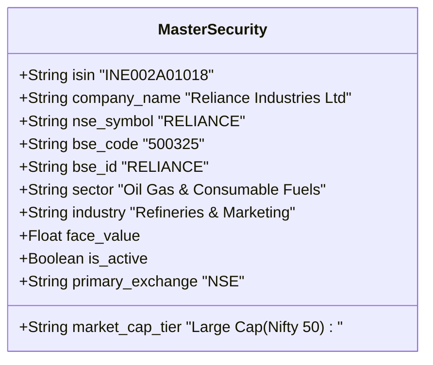
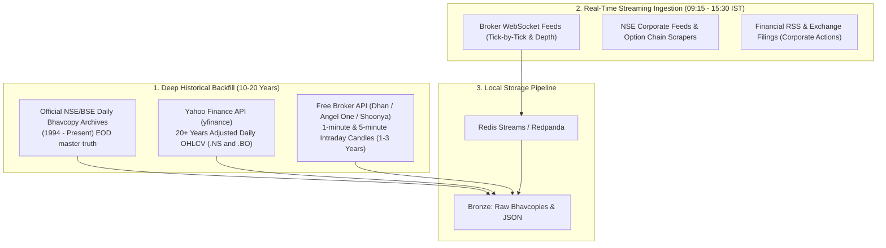
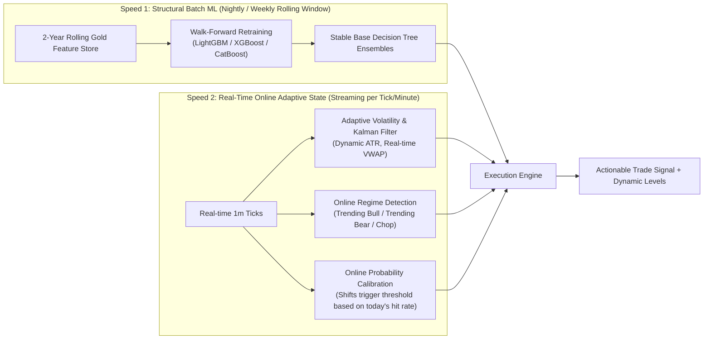
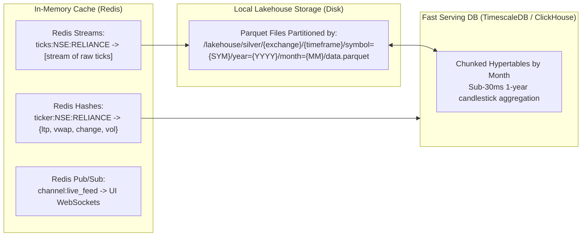

# MarketIntel: Deep Technical Design & Architectural Grilling Document
## Indian Stock Market Intelligence, High-Throughput Data Platform & AI Trading System

---

### 1. Master Universe: Dual Exchange (NSE & BSE) Normalization

Indian equities trade across two primary exchanges. A robust institutional design requires handling dual listing, scrip mapping, and corporate linkages.



#### Dual-Exchange Data Architecture:
1. **ISIN as the Golden Key**:
   - All securities in India carry an ISIN (e.g., `INE002A01018`).
   - The master security table maps `ISIN <-> NSE_SYMBOL <-> BSE_CODE`.
   - **Active Universe Count**: ~2,250 NSE listed equities + ~5,400 BSE listed equities (~4,000 unique operating companies after cross-listing de-duplication).
2. **Exchange Preference Routing**:
   - By default, liquid execution & tick feeds route to **NSE** (higher order-book liquidity, tighter spreads).
   - If a scrip is exclusively listed on **BSE** (common for small/micro-caps), the engine automatically switches to the BSE feed.
   - Cross-exchange spread & arbitrage tracking: Detects temporary price divergence between NSE and BSE quotes.

---

### 2. Historical & Real-Time Data Sourcing Strategy (Zero-Cost)



1. **Daily Historical Data (EOD)**:
   - **NSE & BSE Bhavcopies**: Official exchange end-of-day summary files released every evening. We write an automated archive crawler that downloads Bhavcopy history since 2000. Provides absolute historical truth (Open, High, Low, Close, Volume, Delivery Quantity, Delivery Percentage).
   - **Yahoo Finance (`yfinance`)**: Fast bulk downloader for 20+ years of split/dividend adjusted daily bars.
2. **Intraday Historical Data (1-min / 5-min)**:
   - **Angel One SmartAPI / DhanHQ / Shoonya**: Free historical endpoints allow paginated fetching of 1-minute historical candles back 1 to 3 years.
3. **Daily Live Data Capture**:
   - The local ingestion service boots up at 09:00 IST, connects to Broker WebSockets, streams all trades into local storage, and aggregates 1m/5m/1h candles on the fly.

---

### 3. Online ML vs. Batch ML: The Quant Engineering Reality

> [!IMPORTANT]
> **Why Pure "Online ML" Fails in Financial Markets**:
> True online incremental training (updating neural net weights or tree thresholds on every tick using SGD or `River`) has catastrophic failure modes in stock trading:
> 1. **Catastrophic Forgetting**: If the market enters a 2-hour sideways chop, the model forgets how to trade explosive morning breakouts.
> 2. **Overfitting to Noise & Whipsaws**: A single 1-minute algorithmic stop-hunt wick alters the model's weights, corrupting future predictions.
> 3. **Non-Stationarity**: Market distribution shifts constantly between low volatility, high volatility, and trending regimes.

#### The Institutional Solution: Two-Speed Hybrid Learning Architecture



1. **Macro / Mid-Frequency Layer (Batch Rolling Walk-Forward)**:
   - Models are trained on a rolling window (e.g., past 2 years of data, refit every weekend).
   - Evaluated using **Purged Walk-Forward Cross-Validation** (prevents future lookahead bias).
2. **Micro / Real-Time Layer (Online Adaptive Tracking)**:
   - **Streaming ATR & EWMA Volatility**: Updates volatility estimates every minute.
   - **Market Regime Classifier**: Determines if current price action is trending or oscillating, automatically flipping between Breakout strategy and Mean-Reversion strategy.
   - **Dynamic Probability Thresholding**: If the market is choppy, the system automatically demands an 85% confidence score before entry; in strong trends, it accepts 70%.

---

### 4. Two-Tier AI Pipeline: Selection $\rightarrow$ Timing $\rightarrow$ Risk $\rightarrow$ Sizing

Attempting to run complex deep learning models on all 2,000+ stocks simultaneously in real time will choke any CPU. Instead, we use a hierarchical funnel:

```mermaid
flowchart TD
    A["Universe (2,000+ NSE/BSE Stocks)"] -->|Stage 1: Pre-Market Screener (08:45 IST)| B["Focus List (Top 15-20 Stocks for the Day)"]
    B -->|Stage 2: Real-Time Micro-Timing ML (1m/5m Candles)| C["Trade Signal Trigger (Buy / Sell with >75% Confidence)"]
    C -->|Stage 3: Adaptive Risk & Exit Calculator| D["Exact Stop-Loss, Target 1, Target 2, Trailing Rules"]
    D -->|Stage 4: Volatility-Adjusted Sizing Engine| E["Calculated Order Quantity based on 1% Max Risk"]
    E -->|Stage 5: Virtual Order Manager| F["Execution Ledger & Paper Trading Journal"]
```

#### Detailed Breakdown of Each Stage:

#### Stage 1: Universe Selection (Cross-Sectional Ranking ML)
- Runs pre-market (08:45–09:15 IST) and refreshes hourly.
- Filters out illiquid stocks (minimum daily turnover ₹10 Crores).
- Ranks stocks using:
  - **Sector Relative Momentum**: Money flow into Sector vs NIFTY 50.
  - **Volume Breadth**: Spikes in delivery volume over 5-day / 20-day averages.
  - **Volatility Contraction Pattern (VCP)**: Stocks coiling near multi-month highs.
- **Output**: 10 Bullish Focus stocks + 10 Bearish Focus stocks.

#### Stage 2: Micro-Timing ML (Streaming Signal)
- Only processes the 20 Focus Stocks (reducing CPU load by 99%).
- Features include:
  - Technical indicators: Supertrend, Multi-EMA slope, MACD histogram velocity, RSI divergence.
  - Candlestick Microstructure: Upper wick ratio, body ratio, lower wick ratio, Volume-at-Price (VWAP bands).
- Produces: **Probabilistic Buy / Hold / Sell** with SHAP explainability.

#### Stage 3: Adaptive Risk Engine & Dynamic Trailing Stop-Loss
- **Initial Stop-Loss**: Placed at $\text{Entry} - (1.5 \times \text{ATR}_{14})$ or the lowest low of the last 3 candles (whichever is tighter).
- **Target 1**: Placed at $+1.5R$ (where $R = \text{Entry} - \text{Initial SL}$).
- **Exit Strategy**:
  - At **Target 1**: Close **50% of position**, move Stop-Loss to **Breakeven** ($\text{Entry} + \text{Brokerage/Slippage}$).
  - Remainder 50%: Trailed using **Adaptive Chandelier / Supertrend exit** to capture extended multi-day rallies.

#### Stage 4: Volatility-Adjusted Position Sizing
- Capital preservation rule: **Never risk more than $P\%$ of total portfolio equity on any single trade** (default: 1.0%).
$$\text{Trade Quantity} = \left\lfloor \frac{\text{Portfolio Equity} \times \text{Risk \%}}{\text{Entry Price} - \text{Stop Loss Price}} \right\rfloor$$
- If a stock is highly volatile ($\text{large ATR} \rightarrow \text{wider SL}$), the quantity is automatically scaled down. If a stock has tight consolidation ($\text{small ATR} \rightarrow \text{narrow SL}$), the quantity is scaled up—guaranteeing fixed downside risk.

---

### 5. Multi-Modal Technical Data & Chart Patterns in ML

Can we feed technical chart images or patterns to ML? **Yes, through two proven techniques**:

1. **Numerical Candlestick Vectorization (Fastest & Most Accurate)**:
   Instead of slow image generation and 2D-CNNs, represent candle anatomy mathematically:
   - Body Height Ratio: $\frac{|\text{Close} - \text{Open}|}{\text{High} - \text{Low}}$
   - Upper Shadow Ratio: $\frac{\text{High} - \max(\text{Open}, \text{Close})}{\text{High} - \text{Low}}$
   - Lower Shadow Ratio: $\frac{\min(\text{Open}, \text{Close}) - \text{Low}}{\text{High} - \text{Low}}$
   - Direction: $\text{sign}(\text{Close} - \text{Open})$
   - Gap Ratio: $\frac{\text{Open}_t - \text{Close}_{t-1}}{\text{ATR}_t}$
   *Tree-based models (LightGBM) learn hammers, engulfing candles, and dojis instantly from these 5 features without needing a GPU.*

2. **Computer Vision / 1D-CNN / Gramian Angular Fields (GAF)**:
   - Converts a sequence of 60 5-minute candles into an image/matrix preserving temporal correlations.
   - A lightweight 1D-CNN or ResNet-18 model detects multi-candle chart formations (Cup & Handle, Head & Shoulders, Flag Breakouts).

---

### 6. High-Throughput Local Storage, Sharding & Redis Caching

To guarantee sub-second UI rendering and handle hundreds of gigabytes of historical data on a local workstation:



#### Sharding & Partitioning Tactics:
1. **Partition Pruning in Parquet/Delta Lake**:
   - Organized as: `/lakehouse/silver/{exchange}/{timeframe}/symbol={SYMBOL}/year={YYYY}/month={MM}/data.parquet`
   - When the user opens `RELIANCE` for the last 30 days, DuckDB only reads 1 single 4MB parquet file—it never touches the other 1,999 stocks or past years.
2. **Redis Memory Optimization**:
   - `Redis Hashes` store the latest quote for all 2,000+ stocks in under **15 MB of RAM** with $O(1)$ read latency.
   - `Redis Streams` buffer incoming ticks with a `MAXLEN ~100,000` cap to prevent memory bloat, persisting batches to Bronze Parquet asynchronously.
3. **TimescaleDB / ClickHouse Local Chunking**:
   - Hypertables partitioned into weekly/monthly chunks. Old historical chunks are automatically compressed with columnar compression (80% disk space reduction).

