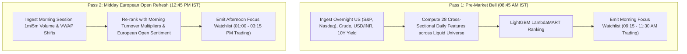
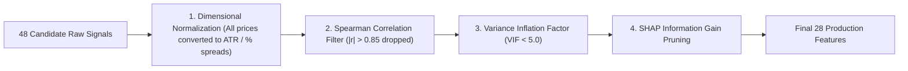

# Model 0: Pre-Market Universe Screener & Cross-Sectional ML Ranker
## Final Production Architecture, Feature Dictionary & Technical Specification

---

## 1. Executive Summary & Objective

Model 0 serves as the primary quantitative gatekeeper for the entire MarketIntel platform. Out of the ~2,357 active listed equities on NSE/BSE, Model 0 evaluates the liquid universe and ranks every stock cross-sectionally to output a high-conviction **Focus Universe** (Maximum Top 10 Longs and Top 10 Shorts).

- **Core Goal**: Identify stocks with the highest statistical probability of massive, clean directional intraday expansion ($R > 1.5 \times ATR_{14}$) on that specific trading day.
- **System Benefit**: Eliminates 99% of market noise, isolates institutional alpha, and prevents CPU/network throttling by allowing the downstream micro-timing engine (Model 1) to track only high-conviction candidates.

---

## 2. Execution Schedule (Two-Pass Cadence)

---

## 3. Pre-Filter: Dynamic Liquidity Gate

To prevent slippage, impact cost, and pump-and-dump manipulation, any stock failing the liquidity gate is excluded prior to feature calculation:
1. **20-Day Average Daily Turnover**: $\ge \text{₹}10\text{ Crores}$ ($\sum_{t-20}^{t} \text{Close} \times \text{Volume} / 20 \ge 100,000,000$).
2. **20-Day Average Daily Volume**: $\ge 100,000\text{ shares}$.
3. **Tradable Status**: Active equity (Series `EQ` or BSE `A`/`B` group).

*Universe Result*: Filters ~2,357 equities down to **~850 institutional-grade tradeable stocks** (NIFTY 50, NIFTY NEXT 50, NIFTY MIDCAP 150, liquid NIFTY SMALLCAP 250, and all active F&O equities).

---

## 4. Machine Learning Formulation

- **Algorithm**: **LightGBM / CatBoost Learning-to-Rank (LambdaMART)**.
- **Why Ranking over Classification?** 
  - Standard classifiers evaluate stocks in isolation.
  - A Ranker evaluates all ~850 stocks **simultaneously within each trading day group**, ordering them relative to peers based on expected expansion potential.
- **Ground Truth Target ($y$)**:
  $$\text{Target}_{\text{Long}} = \frac{\text{Day High} - \text{Open}}{\text{ATR}_{14}} \quad , \quad \text{Target}_{\text{Short}} = \frac{\text{Open} - \text{Day Low}}{\text{ATR}_{14}}$$
  - Targets are normalized by $ATR_{14}$ so high-priced stocks (e.g. MRF) and low-priced stocks (e.g. Tata Steel) are evaluated on identical, dimensionless volatility-adjusted scales.
- **Cross-Validation Split**: **Purged Group TimeSeriesSplit** grouped by trading date with an embargo window of 5 days to eliminate any possibility of lookahead bias or autocorrelation leakage.

---

## 5. Anti-Multicollinearity & Feature Pruning Pipeline

To prevent feature dilution, noisy SHAP values, and overfitting:

1. **Dimensional Normalization**: Zero raw price features (e.g. Close, High, Low) are fed to the model. All indicators are expressed as percentages, log returns, or ATR-normalized distances.
2. **Correlation Matrix Filtering**: Any feature pair exhibiting $|r| > 0.85$ triggers an automatic pruning step where the feature with lower Mutual Information with the target is eliminated.
3. **Variance Inflation Factor (VIF)**: VIF is computed; multicollinear features with $VIF \ge 5.0$ are pruned.
4. **SHAP Tree Selection**: The final model retains only the top 28 most predictive, orthogonal features.

---

## 6. Final Production Feature Dictionary (28 Features)

All 28 features are derived directly from the Silver lakehouse tables already on disk:

### Category A: Multi-Timeframe Trend & Momentum (Normalized)
| # | Feature Name | Formula / Derivation | Source Table | Description |
| :-: | :--- | :--- | :--- | :--- |
| 1 | `ret_1d` | $\ln(Close_t / Close_{t-1})$ | `silver/ohlcv_1d/` | 1-Day Log Return (Immediate momentum) |
| 2 | `ret_3d` | $\ln(Close_t / Close_{t-3})$ | `silver/ohlcv_1d/` | 3-Day Short-term Momentum |
| 3 | `ret_5d` | $\ln(Close_t / Close_{t-5})$ | `silver/ohlcv_1d/` | 5-Day Weekly Swing Momentum |
| 4 | `ret_21d` | $\ln(Close_t / Close_{t-21})$ | `silver/ohlcv_1d/` | 1-Month Cyclical Trend |
| 5 | `dist_ema20_atr` | $(Close_t - EMA_{20}) / ATR_{14}$ | `silver/ohlcv_1d/` | Volatility-normalized distance to 20 EMA |
| 6 | `dist_ema200_atr` | $(Close_t - EMA_{200}) / ATR_{14}$ | `silver/ohlcv_1d/` | Volatility-normalized distance to 200 EMA (Macro trend) |
| 7 | `rsi_14` | 14-period Wilder RSI | `silver/ohlcv_1d/` | Momentum exhaustion oscillator (0 to 100) |
| 8 | `adx_14` | 14-period Directional Trend Strength | `silver/ohlcv_1d/` | Trend strength (Orthogonal to RSI; direction-agnostic) |

### Category B: Volatility Compression & Breakout Setup
| # | Feature Name | Formula / Derivation | Source Table | Description |
| :-: | :--- | :--- | :--- | :--- |
| 9 | `bb_squeeze_pct` | $(UpperBB_{20,2} - LowerBB_{20,2}) / SMA_{20}$ | `silver/ohlcv_1d/` | Bollinger Band Squeeze (low = explosive coiling) |
| 10 | `atr_ratio_5_20` | $ATR_5 / ATR_{20}$ | `silver/ohlcv_1d/` | Volatility expansion velocity |
| 11 | `parkinson_vol_10d` | $\sqrt{\frac{1}{4 \ln 2 \cdot 10} \sum \ln(High_i / Low_i)^2}$ | `silver/ohlcv_1d/` | Extreme-value intra-period volatility estimator |
| 12 | `dist_52w_high_pct` | $(Close_t - \max_{252}(High)) / \max_{252}(High)$ | `silver/ohlcv_1d/` | Distance to 52-week High (breakout proximity) |

### Category C: Volume & Institutional Accumulation Footprints
| # | Feature Name | Formula / Derivation | Source Table | Description |
| :-: | :--- | :--- | :--- | :--- |
| 13 | `rvol_20` | $Volume_t / SMA_{20}(Volume)$ | `silver/ohlcv_1d/` | Relative Volume surge vs 20-day baseline |
| 14 | `volume_trend_5_20` | $SMA_5(Volume) / SMA_{20}(Volume)$ | `silver/ohlcv_1d/` | Volume persistence over trailing week |
| 15 | `delivery_pct` | $DeliveryVolume_t / TradedVolume_t$ | `silver/corporate/` | NSE Delivery Percentage (Smart money accumulation) |
| 16 | `delivery_spike_ratio` | $Delivery\%_t / SMA_{10}(Delivery\%)$ | `silver/corporate/` | Delivery spike ratio vs 10-day baseline |

### Category D: Sector Alpha & Benchmark Relative Strength
| # | Feature Name | Formula / Derivation | Source Table | Description |
| :-: | :--- | :--- | :--- | :--- |
| 17 | `rs_vs_sector_5d` | $Ret5D_{Stock} - Ret5D_{Sector}$ | `silver/macro/`, `silver/master/` | Stock 5D Alpha relative to its assigned Sector Index |
| 18 | `rs_vs_nifty_5d` | $Ret5D_{Stock} - Ret5D_{NIFTY50}$ | `silver/macro/` | Stock 5D Alpha relative to Nifty 50 benchmark |
| 19 | `sector_momentum_rank`| $\text{DenseRank}_{1..14}(SectorRet5D)$ | `silver/macro/` | Cross-sectional rank of assigned sector's strength |
| 20 | `beta_nifty_60d` | $\text{Cov}(R_S, R_N) / \text{Var}(R_N)$ over 60 days | `silver/macro/`, `silver/ohlcv_1d/` | Stock sensitivity to broader market swings |

### Category E: Global Correlators & Overnight Spillover (Pre-Market)
| # | Feature Name | Formula / Derivation | Source Table | Description |
| :-: | :--- | :--- | :--- | :--- |
| 21 | `sp500_overnight_ret`| $\ln(Close_{US, t} / Close_{US, t-1})$ | `silver/macro/global/` | US S&P 500 overnight return |
| 22 | `nasdaq_overnight_ret`| $\ln(Close_{US, t} / Close_{US, t-1})$ | `silver/macro/global/` | US Nasdaq 100 overnight return (Key for IT sector) |
| 23 | `crude_oil_ret_3d` | $\ln(Close_{Crude, t} / Close_{Crude, t-3})$ | `silver/macro/global/` | WTI Crude Oil 3D drift (Key for Oil/Paints/Aviation) |
| 24 | `usdinr_ret_1d` | $\ln(Close_{USD, t} / Close_{USD, t-1})$ | `silver/macro/global/` | USD/INR currency return (Key for Exporters/Importers)|
| 25 | `us_10y_yield_delta` | $Yield_{10Y, t} - Yield_{10Y, t-1}$ | `silver/macro/global/` | US 10-Year Treasury Yield change (Global liquidity) |

### Category F: Institutional Flows, Volatility Regime & Corporate Events
| # | Feature Name | Formula / Derivation | Source Table | Description |
| :-: | :--- | :--- | :--- | :--- |
| 26 | `india_vix_zscore_20d`| $(VIX_t - \mu_{20}(VIX)) / \sigma_{20}(VIX)$ | `silver/macro/` | India VIX normalized fear/complacency score |
| 27 | `fii_flow_5d_norm` | $\sum_{t-5}^t \text{FII\_Net} / \text{Baseline}$ | `silver/macro/fii_dii_flows` | 5-Day Cumulative FII Net Cash Flow Trend |
| 28 | `earnings_proximity_flag` | Days to next Corporate Result | `silver/corporate/` | Proximity to earnings window (-3 to +3 days)|

---

## 7. Dynamic Conviction Filter (No Arbitrary Trading Quotas)

- **Hard Capacity Limit**: Maximum 10 Longs and 10 Shorts.
- **Model Conviction Threshold**: A stock must score above the **70th percentile rank score** ($\hat{y} \ge 0.70$) to be passed into the trading basket.
- **Adaptive Market Behavior**:
  - **High-Momentum Trending Days**: Emits 8–10 Longs or Shorts.
  - **Choppy / Flat / Low-Volume Days**: Emits only 2–4 stocks, or **0 stocks**.
  - **The system preserves capital on choppy days by never forcing low-probability trades.**

---

## 8. Physical Storage & Schema Contract (Gold Layer)

Features are written daily to the partitioned Gold lakehouse:
- **Path**: `data/lakehouse/gold/features_screener_ranking/`
- **Partitioning**: `partition_by=["year", "month"]` as compressed Apache Parquet (`zstd`, compression level 3).
- **Interface**: Exposed directly to DuckDB for ultra-low latency SQL joins (`SELECT * FROM gold.features_screener_ranking WHERE date = CURRENT_DATE`).

---

## 9. Next Pipeline Hand-Off

Once Model 0 runs at 08:45 AM / 12:45 PM, its output watchlist payload is transferred directly to **Model 1 (Short-Term Intraday / Micro-Timing 1m/5m Execution Model)** to await precise candle-by-candle entry triggers.
