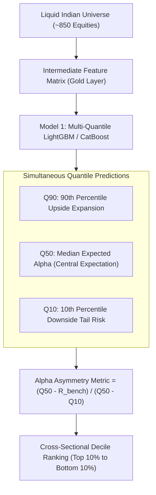
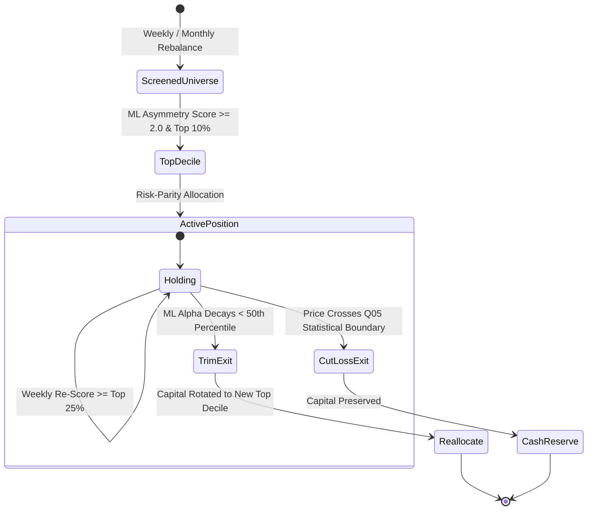

# Model 1: Positional & Swing Alpha Engine (Holding Period: < 1 Year)
## Production Architecture, Quantile Formulation, Feature Dictionary & Live Execution Contract

---

## 1. Executive Summary & Core Mandate

Model 1 is the platform's **Positional and Medium-Term Alpha Engine**. It is designed for multi-week to multi-month swing cycles (**Holding Horizon: 1 to 9 Months, strictly < 1 Year**).

- **Core Mandate**: Systematically exploit institutional momentum, sector rotation, and volatility expansion across the liquid Indian equity universe to generate asymmetric positive alpha ($R > +20\%\text{ to }+80\%$) while mathematically restricting portfolio drawdown.
- **Philosophy**: **100% Machine Learning Driven**. Replaces rigid, static retail rules (like arbitrary moving average crossovers or fixed percentage stop-losses) with continuous probabilistic quantile modeling, dynamic volatility invariance, and statistical tail-risk invalidation boundaries.

---

## 2. Quantitative ML Formulation

### A. Ground Truth Target (Label Formulation)
Model 1 targets the **Forward 63-Trading-Day (~3-Month) Risk-Adjusted Alpha** relative to the NIFTY 50 benchmark:
$$\text{Target}_i = \frac{R_{i, t \rightarrow t+63} - R_{\text{NIFTY50}, t \rightarrow t+63}}{\text{Max Drawdown}_{i, t \rightarrow t+63} + \epsilon}$$
- **Excess Return**: Ensures the model only rewards stocks that genuinely outperform the broader market tide.
- **Drawdown Penalty**: Penalizes erratic, high-volatility paths in favor of smooth, steady institutional compounders.

### B. Multi-Quantile Pinball Loss Architecture
Model 1 is trained using **Pinball (Quantile) Loss** at three distinct probability levels ($\alpha \in \{0.10, 0.50, 0.90\}$):
1. **$Q_{90}$ (Upside Potential)**: How far can the stock run in a favorable multi-quarter expansion?
2. **$Q_{50}$ (Median Expected Alpha)**: The realistic central trajectory.
3. **$Q_{10}$ (Downside Tail Risk)**: The worst-case drawdown expected under adverse market conditions.

### C. Training Protocol: Purged Group TimeSeriesSplit with Embargo
To strictly eliminate overlapping-target data leakage across 63-day horizons:
- **Grouping**: Grouped strictly by trading date.
- **Embargo Window**: A **60-trading-day buffer** is placed between training and validation folds.
- **Guarantee**: The model never sees overlapping future dates during training or cross-validation.

---

## 3. End-to-End ML Decision Lifecycle

### 1. ML Dynamic Entry
- **Alpha Asymmetry Ratio**:
  $$\text{Asymmetry Ratio} = \frac{Q_{50} - R_{\text{benchmark}}}{Q_{50} - Q_{10}}$$
- **Trigger**: The platform enters a stock only when:
  1. Asymmetry Ratio $\ge 2.0$ (Upside is at least double the downside tail risk).
  2. The stock ranks in the **Top 10th percentile** of the liquid universe.
  3. The stock’s sector index is in an expanding or non-contracting regime.

### 2. ML Dynamic Holding (Riding Multi-Month Waves)
- **Zero Static Holding Clocks**: If a stock continues to compound for 6 to 9 months, Model 1 continues holding.
- **Weekly Re-Score**: Every week, Model 1 re-ranks the active portfolio.
- **Hold Condition**: A position is held as long as its predicted forward alpha remains in the **Top 25%** of the universe and institutional delivery trends remain supportive.

### 3. ML Dynamic Exit & Rotation (Alpha Decay)
- **Alpha Decay Trigger**: When a stock’s predicted alpha score drops below the universe median ($< 50\text{th percentile}$), the ML model detects institutional exhaustion or sector rotation.
- **Action**: The system systematically liquidates the position and reallocates capital into an emerging top-decile candidate.

### 4. ML Invalidation Stop-Loss (Dynamic Tail Boundary)
- **No Static Percentages**: No arbitrary "-5%" or "-10%" stops.
- **Statistical Invalidation Boundary ($Q_{05}$)**:
  $$\text{Invalidation Price} = \text{Entry Price} \times (1 - |Q_{05, \text{downside}}|)$$
- **Rule**: If price closes below this 95% statistical boundary, the quantitative hypothesis is mathematically invalidated $\rightarrow$ **Immediate exit**.

---

## 4. Production Feature Dictionary (25 Intermediate Features)

All 25 features are stationary, normalized, and derived directly from the Silver lakehouse:

### Category A: Intermediate Momentum & Trend Structure
| # | Feature Name | Formula / Derivation | Source Table | Purpose |
| :-: | :--- | :--- | :--- | :--- |
| 1 | `ret_21d` | $\ln(Close_t / Close_{t-21})$ | `silver/ohlcv_1d/` | 1-Month Cyclical Momentum |
| 2 | `ret_63d` | $\ln(Close_t / Close_{t-63})$ | `silver/ohlcv_1d/` | 1-Quarter Intermediate Momentum |
| 3 | `ret_126d` | $\ln(Close_t / Close_{t-126})$ | `silver/ohlcv_1d/` | 6-Month Macro Momentum |
| 4 | `dist_ema50_atr` | $(Close_t - EMA_{50}) / ATR_{20}$ | `silver/ohlcv_1d/` | Distance to institutional 50 EMA (in ATRs) |
| 5 | `dist_ema200_atr`| $(Close_t - EMA_{200}) / ATR_{20}$ | `silver/ohlcv_1d/` | Structural macro trend alignment |
| 6 | `rsi_weekly_14` | 14-period RSI computed on Weekly closes | `silver/ohlcv_1d/` | Higher-timeframe momentum exhaustion |
| 7 | `adx_daily_14` | 14-period ADX on Daily closes | `silver/ohlcv_1d/` | Non-directional trend strength |

### Category B: Trend Persistence & Non-Randomness Metrics
| # | Feature Name | Formula / Derivation | Source Table | Purpose |
| :-: | :--- | :--- | :--- | :--- |
| 8 | `hurst_exponent_60d` | Rescaled Range ($R/S$) over 60 bars | `silver/ohlcv_1d/` | $H > 0.6$: Persistent trend; $H \approx 0.5$: Noise |
| 9 | `variance_ratio_60d` | $\text{Var}(r_{5d}) / (5 \times \text{Var}(r_{1d}))$ | `silver/ohlcv_1d/` | Test of random walk vs trending momentum |
| 10 | `sharpe_ratio_63d` | $\text{Mean}(r_{1d}) / \text{Std}(r_{1d}) \times \sqrt{252}$ | `silver/ohlcv_1d/` | Smoothness of intermediate price trajectory |

### Category C: Institutional Accumulation Footprints (Smart Money)
| # | Feature Name | Formula / Derivation | Source Table | Purpose |
| :-: | :--- | :--- | :--- | :--- |
| 11 | `delivery_trend_60d` | 60-day Linear Regression slope of Delivery % | `silver/corporate/` | Multi-month smart money accumulation |
| 12 | `delivery_pct_mean_20d` | 20-day rolling average Delivery % | `silver/corporate/` | Baseline delivery absorption level |
| 13 | `fii_flow_quarterly_sum`| 63-day cumulative FII Net Inflow (₹ Cr) | `silver/macro/fii_dii_flows` | Macro institutional capital tide |
| 14 | `dii_flow_quarterly_sum`| 63-day cumulative DII Net Inflow (₹ Cr) | `silver/macro/fii_dii_flows` | Domestic mutual fund institutional support |

### Category D: Sector Alpha & Benchmark Relative Strength
| # | Feature Name | Formula / Derivation | Source Table | Purpose |
| :-: | :--- | :--- | :--- | :--- |
| 15 | `rs_vs_sector_63d` | $Ret63D_{Stock} - Ret63D_{Sector}$ | `silver/macro/`, `silver/master/` | Quarterly Alpha vs Industry Peers |
| 16 | `rs_vs_nifty_63d` | $Ret63D_{Stock} - Ret63D_{NIFTY50}$ | `silver/macro/` | Quarterly Alpha vs Benchmark |
| 17 | `sector_momentum_rank_3m`| Cross-sectional rank (1..14) of sector 63D return | `silver/macro/` | Captures hot quarterly sector rotations |
| 18 | `beta_nifty_126d` | 126-day rolling regression slope vs NIFTY 50 | `silver/macro/` | Systematic market risk factor |

### Category E: Multi-Month Volatility & Range Expansion
| # | Feature Name | Formula / Derivation | Source Table | Purpose |
| :-: | :--- | :--- | :--- | :--- |
| 19 | `parkinson_vol_60d` | 60-day Parkinson High-Low volatility | `silver/ohlcv_1d/` | True underlying volatility estimator |
| 20 | `bb_width_percentile_126d`| Percentile rank of BB Width over 6 months | `silver/ohlcv_1d/` | Identifies multi-month volatility compression |
| 21 | `dist_52w_high_pct` | $(Close_t - \max_{252}(High)) / \max_{252}(High)$ | `silver/ohlcv_1d/` | Proximity to 52-week breakout trigger |

### Category F: Macro Cycle Sensitivities & Event Windows
| # | Feature Name | Formula / Derivation | Source Table | Purpose |
| :-: | :--- | :--- | :--- | :--- |
| 22 | `india_vix_60d_regime`| $VIX_t / SMA_{60}(VIX)$ | `silver/macro/` | Multi-month market volatility regime |
| 23 | `usdinr_sensitivity_60d`| Rolling correlation of stock return vs USD/INR | `silver/macro/global/` | Currency shock vulnerability/benefit |
| 24 | `crude_oil_beta_60d` | Rolling regression coefficient vs Crude Oil | `silver/macro/global/` | Sensitivity to energy commodity cycles |
| 25 | `us_10y_yield_trend_60d`| 60-day change in US 10-Year Treasury Yield | `silver/macro/global/` | Global cost of capital shift |

---

## 5. Live Trading Engine Bridge & Execution Mechanics

### A. Portfolio Architecture & Capital Sizing
1. **Total Portfolio Capital ($C_{\text{total}}$)**: Configured in user settings (e.g. ₹10,00,000).
2. **Target Portfolio Size**: **10 to 12 simultaneous positions** (provides institutional diversification with concentrated alpha).
3. **Risk-Per-Trade Budget**: Maximum **$1.0\%$ to $1.5\%$** of total portfolio capital risked on any single trade:
   $$\text{Max Risk Budget} = C_{\text{total}} \times 0.01 = \text{₹}10,000$$

### B. Dynamic Share Quantity Calculation Formula
The exact number of shares ($Q_i$) to buy for stock $i$ is calculated mathematically:
$$Q_i = \min \left( \left\lfloor \frac{\text{Max Risk Budget}}{|\text{Current Price} - \text{ML Invalidation Price}|} \right\rfloor \, , \, \left\lfloor \frac{C_{\text{total}} \times \text{Max Position Cap}}{\text{Current Price}} \right\rfloor \right)$$
- **Max Position Cap**: Hard ceiling of **$10\%$ of total portfolio capital** in any single stock (e.g. maximum ₹1,00,000 exposure in TCS).
- **Fractional Handling**: Truncated downward to whole integer shares.

### C. Live Order Placement via Angel One SmartAPI
- **Product Type**: `DELIVERY` / `CNC` (Cash-and-Carry for multi-week/month positional holding; zero intraday auto-square-off risk).
- **Order Execution Type**: `LIMIT` order placed at `Close` or VWAP buffer to prevent slippage.
- **Exchange**: `NSE` (primary) with fallback to `BSE`.

### D. Rebalance & Execution Protocol
1. **Cadence**: Every Friday EOD (15:00 IST) or 1st of every month.
2. **Delta Execution**: The engine compares the current live portfolio vs Model 1's newly ranked target weights:
   - Stocks falling out of top quartile $\rightarrow$ Emits `SELL` orders for 100% of holdings.
   - Newly qualified top-decile stocks $\rightarrow$ Emits `BUY` orders with exact calculated $Q_i$ share quantities.
   - Stocks maintaining top quartile rank $\rightarrow$ No unnecessary turnover (saves STT and broker fees).

---

## 6. Physical Lakehouse Destination

- **Path**: `data/lakehouse/gold/features_short_term_positional/`
- **Format**: Apache Parquet (`zstd` compression level 3) partitioned by `year` and `quarter`.
- **Query Engine**: DuckDB SQL interface for millisecond feature extraction and backtesting.

