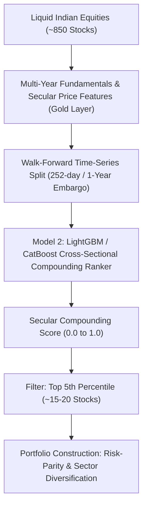
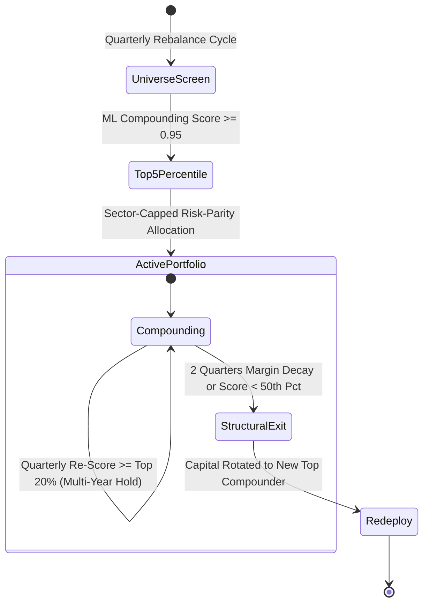

# Model 2: Long-Term Wealth Compounding Engine (Holding Period: > 1 Year)
## Production Architecture, Fundamental Quality Factors, Compounding Formulations & Technical Specification

---

## 1. Executive Summary & Objective

Model 2 serves as the platform's **Long-Term Multi-Bagger and Wealth Compounding Engine**. It is architected for secular investment horizons (**Holding Period: 1 to 5+ Years**).

- **Core Mandate**: Systematically identify, rank, and allocate capital to the top elite Indian businesses that possess durable economic moats, pristine balance sheets, superior capital reinvestment rates (ROCE/ROE), and consistent cash flow generation to achieve **20% to 35%+ CAGR** over multi-year holding periods with minimal drawdown.
- **Philosophy**: Benjamin Graham's institutional axiom: *"In the short run, the market is a voting machine, but in the long run, it is a weighing machine."* Model 2 relies on **100% Machine Learning Cross-Sectional Ranking** of fundamental quality, earnings persistence, and downside volatility invariance, entirely eliminating retail emotional bias.

---

## 2. Quantitative ML Formulation

### A. Ground Truth Target (Label Formulation)
Model 2 predicts the **Forward 3-Year Risk-Adjusted Compounding Alpha** relative to the NIFTY 50 benchmark:
$$\text{Target}_i = \frac{\text{CAGR}_{i, t \rightarrow t+756} - \text{CAGR}_{\text{NIFTY50}, t \rightarrow t+756}}{\text{Downside Semi-Deviation}_{i, 3Y} + \epsilon}$$
- **Forward 3-Year CAGR**: Evaluates multi-year wealth accumulation without being distorted by quarterly noise.
- **Downside Semi-Deviation**: Only penalizes negative price volatility (crashes and severe drawdowns) while treating upside volatility as positive alpha.

### B. Global Cross-Sectional Panel Architecture
- **Single Global Model**: Rather than training 2,357 individual models (which fail due to data starvation), Model 2 is trained as **one unified panel model** across all 2,357 stocks over 25+ years ($10,000,000+$ training rows).
- **Universal Learning**: It learns the fundamental relationships between business quality, capital efficiency, balance sheet safety, and multi-year stock price compounding.

### C. Zero-Leakage Training: 1-Year Purge & Embargo
Because the target looks forward 756 trading days (3 years), we employ **Walk-Forward Time-Series Cross-Validation with a 1-Year (252-day) Embargo Window** between training and validation blocks. This prevents any lookahead leakage of corporate financial statements.

---

## 3. End-to-End ML Decision Lifecycle

### 1. ML Dynamic Entry
- **Trigger**: The platform enters a stock only when:
  1. The stock ranks in the **Top 5th percentile** of the entire universe for secular compounding potential.
  2. The company exhibits positive Operating Cash Flow and debt-to-equity $< 0.8$.
  3. The stock’s 3-year historical downside semi-deviation is within acceptable risk limits.
- **Diversification Constraints**:
  - Portfolio holds **15 to 20 stocks**.
  - Maximum **20% exposure** in any single sector to prevent macroeconomic concentration.

### 2. Multi-Year Holding ("Coffee Can" Strategy)
- **Zero Premature Selling**: If an elite company continues to compound earnings and maintain its top-quintile score, Model 2 **holds it continuously for 2, 3, or 5+ years**.
- **Tax and Friction Efficiency**: Avoids short-term capital gains tax (STCG) and excessive transaction costs.

### 3. ML Structural Exit (Fundamental Breakdown)
A stock is systematically exited if:
1. **Fundamental Degradation**: 2 consecutive quarters of declining operating margins or a sharp jump in debt-to-equity.
2. **Score Decay**: The stock's ML compounding rank falls below the universe median ($< 50\text{th percentile}$).
3. **Action**: Complete liquidation; proceeds are rotated into the highest-ranked qualifying candidate.

---

## 4. Production Feature Dictionary (25 Multi-Year Features)

All 25 features are stationary, normalized, and derived from the Silver lakehouse:

### Category A: Capital Efficiency & Reinvestment Moats
| # | Feature Name | Formula / Derivation | Source Table | Purpose |
| :-: | :--- | :--- | :--- | :--- |
| 1 | `roce_ttm` | $\text{EBIT} / (\text{Total Assets} - \text{Current Liabilities})$ | `silver/corporate/` | Efficiency of capital employment |
| 2 | `roe_ttm` | $\text{Net Income} / \text{Shareholders Equity}$ | `silver/corporate/` | Return on shareholder equity |
| 3 | `reinvestment_rate_3y` | $(\text{Capex} - \text{Depr} + \Delta \text{WC}) / \text{EBIT}$ | `silver/corporate/` | Ability to reinvest profits at high rates |
| 4 | `asset_turnover_ratio` | $\text{Revenue} / \text{Total Assets}$ | `silver/corporate/` | Asset utilization efficiency |

### Category B: Balance Sheet Resilience & Solvency
| # | Feature Name | Formula / Derivation | Source Table | Purpose |
| :-: | :--- | :--- | :--- | :--- |
| 5 | `debt_to_equity` | $\text{Total Debt} / \text{Total Equity}$ | `silver/corporate/` | Leverage risk ($< 0.5$ is high safety) |
| 6 | `interest_coverage_ratio` | $\text{EBIT} / \text{Interest Expense}$ | `silver/corporate/` | Solvency margin against rate shocks |
| 7 | `altman_z_score` | Weighted sum of 5 financial ratios | `silver/corporate/` | Quantitative bankruptcy prediction |
| 8 | `promoter_pledge_pct` | $\text{Pledged Shares} / \text{Promoter Shares}$ | `silver/corporate/` | Corporate governance safety ($0\%$ is gold standard) |

### Category C: Cash Flow Quality & Earnings Persistence
| # | Feature Name | Formula / Derivation | Source Table | Purpose |
| :-: | :--- | :--- | :--- | :--- |
| 9 | `cfo_to_net_profit` | $\text{Operating Cash Flow} / \text{Net Profit}$ | `silver/corporate/` | Checks for aggressive accounting ($> 1.0$ is pristine) |
| 10 | `fcf_yield` | $\text{Free Cash Flow} / \text{Market Cap}$ | `silver/corporate/` | True cash generation yield |
| 11 | `operating_margin_std_3y`| 3-Year Std Dev of Operating Margin | `silver/corporate/` | Pricing power stability across cycles |
| 12 | `sales_cagr_3y` | 3-Year Compound Annual Revenue Growth | `silver/corporate/` | Secular top-line revenue expansion |

### Category D: Long-Term Secular Price Trajectories
| # | Feature Name | Formula / Derivation | Source Table | Purpose |
| :-: | :--- | :--- | :--- | :--- |
| 13 | `sortino_ratio_3y` | $(\text{CAGR}_{3Y} - R_f) / \text{Downside Deviation}_{3Y}$ | `silver/ohlcv_1d/` | Quality of compounding trajectory |
| 14 | `max_drawdown_3y` | $\min_{3Y}((Price - Peak) / Peak)$ | `silver/ohlcv_1d/` | Historical multi-year capital preservation |
| 15 | `calmar_ratio_3y` | $\text{CAGR}_{3Y} / |\text{Max Drawdown}_{3Y}|$ | `silver/ohlcv_1d/` | Return per unit of maximum historical pain |
| 16 | `cagr_relative_sector_3y`| $\text{CAGR}_{3Y, \text{Stock}} - \text{CAGR}_{3Y, \text{Sector}}$ | `silver/macro/`, `silver/ohlcv_1d/` | Multi-year secular alpha vs industry peers |
| 17 | `dist_ath_pct` | $(Close_t - \max_{\text{all}}(High)) / \max_{\text{all}}(High)$ | `silver/ohlcv_1d/` | Distance to all-time high |

### Category E: Institutional Ownership & Accumulation Cycles
| # | Feature Name | Formula / Derivation | Source Table | Purpose |
| :-: | :--- | :--- | :--- | :--- |
| 18 | `fii_holding_trend_4q` | 4-Quarter Linear Regression slope of FII % | `silver/corporate/` | Long-term foreign institutional interest |
| 19 | `dii_holding_trend_4q` | 4-Quarter Linear Regression slope of DII % | `silver/corporate/` | Domestic mutual fund accumulation |
| 20 | `delivery_to_traded_ratio_1y`| 1-Year Average Delivery % | `silver/corporate/` | High baseline delivery absorption |

### Category F: Macro Cycle Resilience & Valuation Anchors
| # | Feature Name | Formula / Derivation | Source Table | Purpose |
| :-: | :--- | :--- | :--- | :--- |
| 21 | `pe_relative_to_5y_median` | $PE_t / \text{Median}_{5Y}(PE)$ | `silver/corporate/` | Mean-reversion valuation sanity check |
| 22 | `dividend_yield_stability` | 5-Year Average Dividend Yield | `silver/corporate/` | Cash payout consistency |
| 23 | `beta_nifty_3y` | 3-Year rolling market beta | `silver/macro/` | Long-term systematic market sensitivity |
| 24 | `crude_oil_sensitivity_3y`| 3-Year rolling elasticity vs WTI Crude | `silver/macro/global/` | Multi-year commodity exposure |
| 25 | `usdinr_sensitivity_3y` | 3-Year rolling elasticity vs USD/INR | `silver/macro/global/` | Multi-year export/import advantage |

---

## 5. Live Trading Engine Bridge & Execution Mechanics

### A. Portfolio Architecture
- **Capital Allocation**: Total capital dedicated to long-term compounding (e.g. 50% to 70% of total wealth).
- **Target Positions**: **15 to 20 stocks** (each position receives roughly **5% to 7%** of the portfolio).
- **Execution Product**: `DELIVERY` / `CNC` on NSE via Angel One SmartAPI.

### B. Dynamic Position Sizing Formula
$$\text{Weight}_i \propto \frac{\text{Compounding Score}_i}{\text{Downside Semi-Deviation}_i^2}$$
- Elite compounders with lower historical crash risk receive higher capital allocation (up to 7.5%).
- Higher-growth but slightly more volatile compounders receive ~4% to 5%.

### C. Rebalance Protocol
- **Cadence**: **Quarterly Review** (runs after quarterly earnings seasons: May 15, August 15, November 15, February 15).
- **Turnover Rate**: Low ($\approx 15\%\text{ to }20\%\text{ annually}$). Only stocks experiencing genuine structural breakdown are replaced.

---

## 6. Physical Lakehouse Destination

- **Path**: `data/lakehouse/gold/features_long_term_swing/` (Partitioned by `year`).
- **Format**: Apache Parquet (`zstd` level 3) integrated directly into DuckDB.

