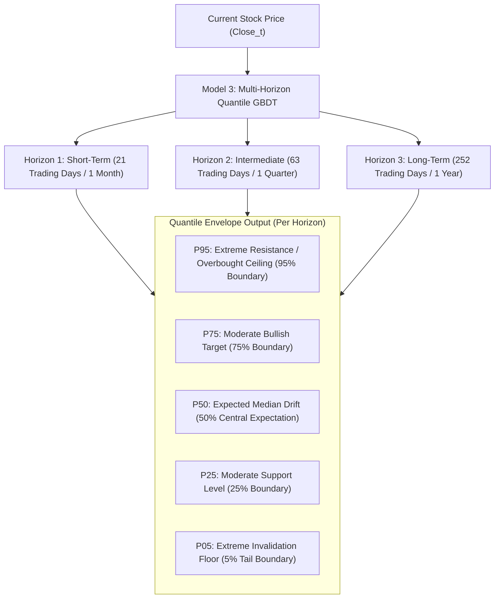
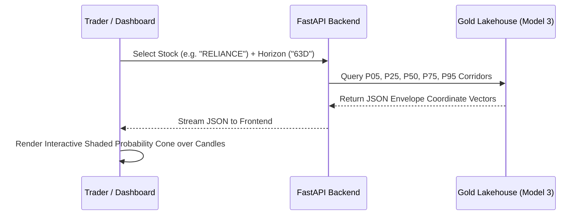

# Model 3: Probabilistic Price Corridor & Volatility Forecaster
## Production Architecture, Quantile Regression Envelopes & Dashboard Visualization Contract

---

## 1. Executive Summary & Core Objective

Model 3 is the platform's **Probabilistic Price Corridor & Volatility Forecaster**. Rather than attempting flawed point-price forecasting, Model 3 generates continuous, calibrated **Statistical Price Envelopes (Probability Cones)** for any stock or index.

- **Core Goal**: Compute the dynamic statistical upper boundary ($P_{95}$ resistance/profit target), central trajectory ($P_{50}$ median path), and lower boundary ($P_{05}$ support/invalidation floor) across multi-timeframe forward horizons.
- **System Role**:
  1. **Serves Model 1 (< 1 Year Swing)**: Dynamically defines the quantitative take-profit ceiling and statistical invalidation stop-loss floor.
  2. **Serves Model 2 (> 1 Year Compounding)**: Identifies extreme oversold accumulation zones when secular compounders touch their lower statistical corridor.
  3. **Powers the Interactive Web Dashboard**: Renders interactive, shaded probability cones on TradingView charts, visually showing the mathematical corridor of expected future prices.

---

## 2. Multi-Horizon Forecasting Engine

Model 3 computes price corridors across **three distinct forward horizons**:

---

## 3. Mathematical ML Formulation

### A. Quantile Regression & Pinball Loss
Model 3 uses **LightGBM / CatBoost Quantile Regression** minimizing the asymmetrical Pinball Loss function:
$$\mathcal{L}_\alpha(y, \hat{y}_\alpha) = \max \Big( \alpha (y - \hat{y}_\alpha) \, , \, (\alpha - 1) (y - \hat{y}_\alpha) \Big)$$
- $\alpha = 0.95$: Penalizes predictions that fall below the actual 95th percentile price peak.
- $\alpha = 0.50$: Median regression (L1 loss on median error).
- $\alpha = 0.05$: Penalizes predictions that exceed the 5th percentile price trough.

### B. Non-Crossing Quantile Guarantee (Isotonic Calibration)
To ensure mathematical validity (e.g. $P_{95} \ge P_{75} \ge P_{50} \ge P_{25} \ge P_{05}$), the engine applies **Isotonic Monotonicity Constraints**:
$$P_{k+1}(t) = \max(P_{k+1}(t), P_k(t))$$
This guarantees that the probability bands never cross or invert, even during extreme market volatility.

---

## 4. Web Dashboard Visual Contract (TradingView Charting)

Model 3 connects directly to the frontend charting engine (TradingView Lightweight Charts / Plotly):

### Visual Specifications on Dashboard:
1. **P95 – P75 Band (Light Green Shading)**: The "Overbought / Profit Target Zone". Reaching this band signals extreme price extension.
2. **P75 – P25 Band (Light Blue Shading)**: The "Normal Volatility Corridor" containing 50% of all expected price action.
3. **P50 Line (Solid Blue Center Line)**: Expected central drift trajectory.
4. **P25 – P05 Band (Light Red Shading)**: The "Oversold / Dip Accumulation Zone".
5. **Below P05 (Dotted Red Line)**: The "Statistical Invalidation Line". A close below this triggers Model 1's stop-loss exit.

---

## 5. Production Feature Dictionary (20 Volatility & Corridor Features)

Model 3 features focus on **volatility dynamics, variance structures, and historical drift**:

### Category A: Multi-Scale Volatility Estimators
| # | Feature Name | Formula / Derivation | Source Table | Purpose |
| :-: | :--- | :--- | :--- | :--- |
| 1 | `parkinson_vol_20d` | Extreme-value High/Low variance (20 days) | `silver/ohlcv_1d/` | Eliminates opening jump bias |
| 2 | `garman_klass_vol_20d`| Open, High, Low, Close variance estimator | `silver/ohlcv_1d/` | 8x more statistically efficient than standard Close-to-Close |
| 3 | `atr_cone_21d` | $ATR_{14} \times \sqrt{21}$ | `silver/ohlcv_1d/` | Baseline volatility expansion cone |
| 4 | `historical_vol_63d` | 63-day annualized standard deviation | `silver/ohlcv_1d/` | Benchmark historical volatility |

### Category B: Volatility Regimes & India VIX Dynamics
| # | Feature Name | Formula / Derivation | Source Table | Purpose |
| :-: | :--- | :--- | :--- | :--- |
| 5 | `vix_current_level` | Absolute closing value of India VIX | `silver/macro/` | Overall market risk environment |
| 6 | `vix_to_historical_ratio`| $VIX_t / SMA_{60}(VIX)$ | `silver/macro/` | Widens/narrows corridor dynamically |
| 7 | `vix_term_structure_slope`| 5-day rate of change of India VIX | `silver/macro/` | Early warning of impending volatility explosions |

### Category C: Trend Persistence, Mean Reversion & Squeeze
| # | Feature Name | Formula / Derivation | Source Table | Purpose |
| :-: | :--- | :--- | :--- | :--- |
| 8 | `bb_width_zscore_60d` | Z-score of Bollinger Band Width over 60 days | `silver/ohlcv_1d/` | Detects extreme compression before corridor breakout |
| 9 | `keltner_channel_spread`| $(UpperKC - LowerKC) / Close$ | `silver/ohlcv_1d/` | True ATR-based price envelope spread |
| 10 | `zscore_from_sma50` | $(Close - SMA_{50}) / \sigma_{50}$ | `silver/ohlcv_1d/` | Mean-reversion pull towards intermediate mean |
| 11 | `hurst_exponent_126d` | Hurst exponent over 6 months | `silver/ohlcv_1d/` | $H > 0.6$: Expanding corridor; $H < 0.4$: Collapsing cone |

### Category D: Macro & Global Beta Elasticity
| # | Feature Name | Formula / Derivation | Source Table | Purpose |
| :-: | :--- | :--- | :--- | :--- |
| 12 | `beta_nifty_volatility`| Ratio of stock volatility to Nifty volatility | `silver/macro/` | Stock's idiosyncratic volatility multiplier |
| 13 | `crude_oil_vol_spread` | 30-day volatility of WTI Crude Oil | `silver/macro/global/` | Macro commodity shock transmission |
| 14 | `us_10y_yield_vol` | 30-day standard deviation of US 10Y Yield | `silver/macro/global/` | Global interest rate uncertainty factor |

---

## 6. Physical Lakehouse Destination

- **Path**: `data/lakehouse/gold/features_price_corridor/`
- **Format**: Apache Parquet (`zstd` compression level 3).
- **Interface**: DuckDB SQL interface providing sub-second probability cone data to the FastAPI backend and TradingView frontend.

