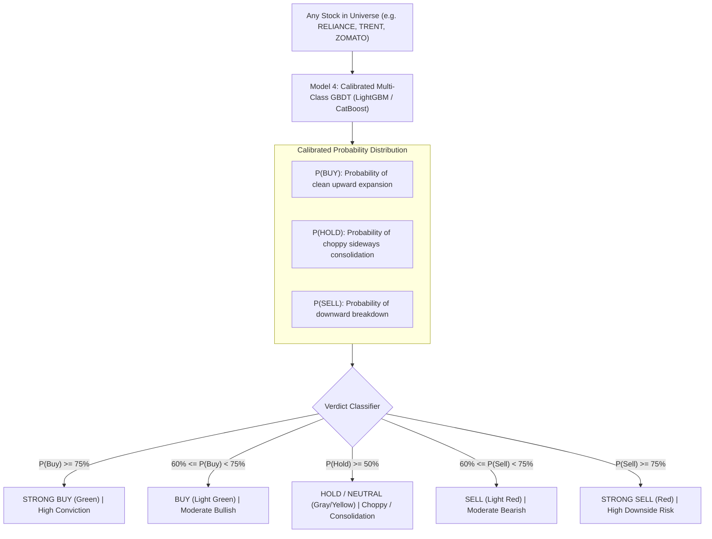

# Model 4: Universal Stock Action & Confidence Classifier
## Production Architecture, Multi-Class Formulation, Feature Dictionary & Gold Storage Specification

---

## 1. Executive Summary & Objective

Model 4 serves as the platform's **Universal Stock Action & Confidence Engine**. While Models 0, 1, and 2 focus on portfolio construction (picking the top 10–20 stocks), Model 4 operates on **EVERY SINGLE STOCK** across the entire 2,357-equity universe.

- **Core Goal**: Provide an instant, authoritative institutional verdict on any searched stock:
  - **Verdict**: `STRONG BUY`, `BUY`, `HOLD / NEUTRAL`, `SELL`, `STRONG SELL`
  - **Calibrated AI Confidence %**: The exact mathematical probability ($\mathcal{P} \in [0.0, 1.0]$) behind the rating.
  - **Primary Catalyst**: The dominant quantitative factor driving the decision (e.g. *"Sector Relative Strength Outperformance"* or *"Delivery Volume Accumulation"*).
- **Dashboard Presentation**: Displayed as a prominent AI Verdict Card on every stock's dashboard page.

---

## 2. Machine Learning Formulation

### A. Ground Truth Target (Label Formulation)
The target evaluates the forward 21-trading-day (~1-month) price behavior using the **Triple Barrier Labeling Method**:
$$\text{Target} = \begin{cases} 
+1 \text{ (BUY)} & \text{if Forward Max Upward Move} \ge +1.5 \times ATR_{14} \text{ AND Drawdown} \le 0.75 \times ATR_{14} \\
-1 \text{ (SELL)} & \text{if Forward Max Downward Move} \le -1.5 \times ATR_{14} \text{ AND Run-up} \le 0.75 \times ATR_{14} \\
0 \text{ (HOLD)} & \text{if price stays confined within } [-1.5 \times ATR_{14}, +1.5 \times ATR_{14}] \text{ (Choppy / Sideways)}
\end{cases}$$

### B. Platt Scaling & Isotonic Probability Calibration
Standard GBDT outputs raw logits which do not represent true probabilities. Model 4 applies **Isotonic Calibration** on the out-of-fold validation set, ensuring that when the model outputs **84% Confidence**, 84 out of 100 historical instances actually succeeded!

---

## 3. Production Feature Dictionary (22 Consensus Features)

Model 4 integrates signals across momentum, volume, sector health, and volatility structure:

### Category A: Multi-Timeframe Trend & Moving Average Alignment
| # | Feature Name | Formula / Derivation | Source Table | Purpose |
| :-: | :--- | :--- | :--- | :--- |
| 1 | `trend_alignment_score`| Weighted sum of $(Close > EMA_{20}, EMA_{50}, EMA_{200})$ | `silver/ohlcv_1d/` | Stacked moving average trend confirmation |
| 2 | `dist_ema20_atr` | $(Close - EMA_{20}) / ATR_{14}$ | `silver/ohlcv_1d/` | Short-term momentum stretch |
| 3 | `dist_ema50_atr` | $(Close - EMA_{50}) / ATR_{14}$ | `silver/ohlcv_1d/` | Intermediate trend support |
| 4 | `dist_ema200_atr`| $(Close - EMA_{200}) / ATR_{14}$ | `silver/ohlcv_1d/` | Macro Bull/Bear regime |
| 5 | `adx_14` | 14-period Average Directional Index | `silver/ohlcv_1d/` | Trend strength (distinguishes trends from chop) |

### Category B: Momentum & Reversal Oscillators
| # | Feature Name | Formula / Derivation | Source Table | Purpose |
| :-: | :--- | :--- | :--- | :--- |
| 6 | `rsi_14` | 14-period Wilder RSI | `silver/ohlcv_1d/` | Overbought ($>70$) vs Oversold ($<30$) |
| 7 | `ret_1d` | 1-Day Log Return | `silver/ohlcv_1d/` | Immediate impulse momentum |
| 8 | `ret_5d` | 5-Day Log Return | `silver/ohlcv_1d/` | Weekly momentum vector |
| 9 | `ret_21d` | 21-Day Log Return | `silver/ohlcv_1d/` | Monthly momentum vector |

### Category C: Volume Quality & Smart Money Accumulation
| # | Feature Name | Formula / Derivation | Source Table | Purpose |
| :-: | :--- | :--- | :--- | :--- |
| 10 | `rvol_20` | $Volume_t / SMA_{20}(Volume)$ | `silver/ohlcv_1d/` | Relative volume surge factor |
| 11 | `volume_trend_5_20` | $SMA_5(Volume) / SMA_{20}(Volume)$ | `silver/ohlcv_1d/` | Multi-day volume persistence |
| 12 | `delivery_spike_ratio` | $\text{Delivery \%}_t / SMA_{10}(\text{Delivery \%})$ | `silver/corporate/` | Smart money delivery accumulation |

### Category D: Sector Alpha & Relative Strength
| # | Feature Name | Formula / Derivation | Source Table | Purpose |
| :-: | :--- | :--- | :--- | :--- |
| 13 | `rs_vs_sector_21d` | $Ret21D_{Stock} - Ret21D_{Sector}$ | `silver/macro/`, `silver/master/` | Stock excess alpha vs its industry sector |
| 14 | `rs_vs_nifty_21d` | $Ret21D_{Stock} - Ret21D_{NIFTY50}$ | `silver/macro/` | Stock excess alpha vs Nifty 50 benchmark |
| 15 | `sector_momentum_rank`| Rank (1..14) of parent sector's 21D return | `silver/macro/` | Sector tailwind confirmation |

### Category E: Volatility Geometry & Range Position
| # | Feature Name | Formula / Derivation | Source Table | Purpose |
| :-: | :--- | :--- | :--- | :--- |
| 16 | `bb_percent_b` | $(Close - LowerBB) / (UpperBB - LowerBB)$ | `silver/ohlcv_1d/` | Position within Bollinger Band (0.0 to 1.0) |
| 17 | `bb_squeeze_pct` | $(UpperBB - LowerBB) / SMA_{20}$ | `silver/ohlcv_1d/` | Volatility compression (breakout imminent) |
| 18 | `atr_ratio_5_20` | $ATR_5 / ATR_{20}$ | `silver/ohlcv_1d/` | Volatility expansion velocity |
| 19 | `dist_52w_high_pct` | $(Close - High_{252}) / High_{252}$ | `silver/ohlcv_1d/` | Proximity to 52-week breakout high |
| 20 | `dist_52w_low_pct` | $(Close - Low_{252}) / Low_{252}$ | `silver/ohlcv_1d/` | Proximity to 52-week breakdown low |

### Category F: Macro Sentiment & Institutional Flow
| # | Feature Name | Formula / Derivation | Source Table | Purpose |
| :-: | :--- | :--- | :--- | :--- |
| 21 | `india_vix_zscore_20d`| $(VIX_t - \mu_{20}(VIX)) / \sigma_{20}(VIX)$ | `silver/macro/` | Market-wide risk appetite/fear state |
| 22 | `fii_flow_20d_norm` | Cumulative 20-day FII flow normalized | `silver/macro/fii_dii_flows` | Foreign institutional liquidity trend |

---

## 4. Physical Lakehouse Destination (Gold Layer)

- **Directory Path**: `data/lakehouse/gold/features_stock_action_classifier/`
- **Format**: Partitioned Apache Parquet (`zstd` compression level 3).
- **Interface**: Exposed to DuckDB for instant sub-millisecond querying from FastAPI backend when rendering stock pages on the web dashboard.

