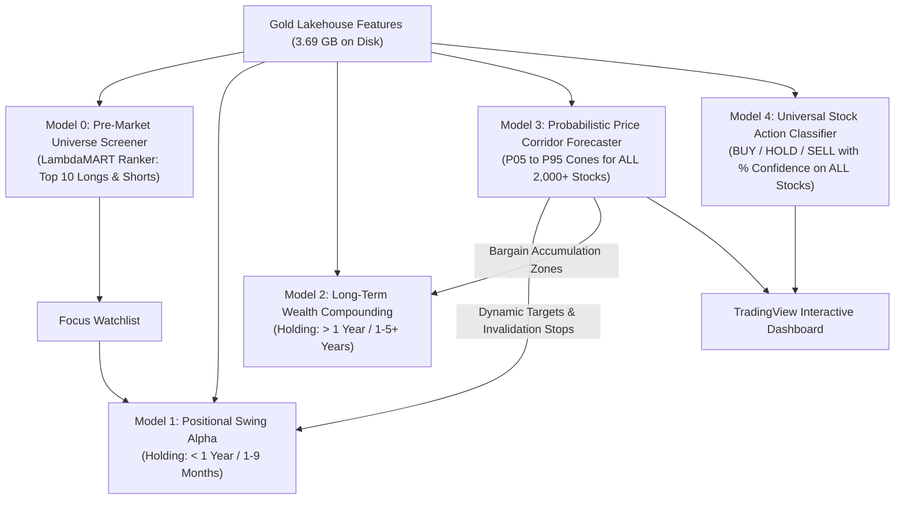
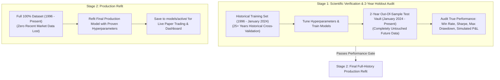

# Phase 4: Institutional AI Engine, Multi-Horizon Quant Models & Adaptive Risk Architecture
## Master Production Specification

---

## 1. Executive Summary & Philosophy

Phase 4 is the quantitative intelligence core of the MarketIntel platform. Operating on the **3.69 GB Gold Lakehouse Feature Stores** created in Phase 2, Phase 4 trains and deploys a synchronized suite of **5 Decoupled Machine Learning Engines**.

- **Philosophy**: 100% Machine Learning Driven. Zero arbitrary retail rules (no fixed percentage stops, no rigid moving average crossovers).
- **Core Standard**: Every model utilizes Purged Group TimeSeries Cross-Validation with dynamic volatility invariance, calibrated probabilities, and asymmetric risk/reward targets.

---

## 2. The 5 Synchronized AI Models

| Model | Formal Name | Target Horizon | Algorithm | Primary Role & Output | Dedicated Gold Store |
| :---: | :--- | :---: | :--- | :--- | :--- |
| **Model 0** | **Pre-Market Universe Screener** | Daily / Intraweek | LightGBM LambdaMART Ranker | Ranks 2,357 stocks cross-sectionally before open; outputs Top 10 Longs & Shorts. | `gold/features_screener_ranking/` |
| **Model 1** | **Positional & Swing Alpha** | **$< 1\text{ Year}$** (1–9 Months) | Multi-Quantile GBDT ($Q_{10}, Q_{50}, Q_{90}$) | Captures explosive multi-month cyclical breakouts; dynamic alpha-decay exits. | `gold/features_short_term_positional/` |
| **Model 2** | **Wealth Compounding Engine** | **$> 1\text{ Year}$** (1–5+ Years) | Secular Compounding Ranker | Ranks top 15–20 elite Indian compounders (high ROCE, pristine balance sheets). | `gold/features_long_term_swing/` |
| **Model 3** | **Probabilistic Price Corridor** | 21D, 63D, 252D | Quantile Pinball Loss ($P_{05}\dots P_{95}$) | Calculates statistical price corridors, dynamic stops, target envelopes, and shaded chart cones. | `gold/features_price_corridor/` |
| **Model 4** | **Universal Action Classifier** | 21 Days (~1 Month) | Calibrated Multi-Class GBDT | Outputs `STRONG BUY`, `BUY`, `HOLD`, `SELL`, `STRONG SELL` with calibrated **Confidence %** on every stock. | `gold/features_stock_action_classifier/` |

---

## 3. The Two-Stage Production Training Protocol

To guarantee **100% honest scientific backtesting proof** while ensuring **zero recent data is lost in production**, Phase 4 implements the institutional two-stage protocol:

### Stage 1: Scientific Verification & Audit (The Proof)
1. **Split Strategy**:
   - **Training Set**: 1996 to **December 31, 2023** (historical cross-validation).
   - **Out-Of-Sample Test Vault**: **January 1, 2024 to Present (2 Full Years)**.
2. **Execution**:
   - Models are trained strictly on pre-2024 data.
   - The models trade the 2024–2026 period **day-by-day in a realistic walk-forward simulation**, tracking simulated fills, slippage, and STT taxes.
3. **Audit Performance Targets**:
   - **Directional Win Rate**: $\ge 55\%$
   - **Annualized Sharpe Ratio**: $\ge 1.8$
   - **Maximum Drawdown**: $\le 12.0\%$
   - **Profit Factor**: $\ge 1.75$

### Stage 2: Final Full-History Production Refit (The Deployment)
1. **Rationale**: A model deployed in production must not be blind to the last 2 years of interest rate shifts, post-2024 election dynamics, and current institutional cash flows.
2. **Execution**:
   - After Stage 1 proves the hyperparameters and strategy work out-of-sample, the models are refit on the **entire 100% dataset (Inception to Present)** using the exact proven hyperparameters.
   - The resulting production artifacts (`model_0.lgb`, `model_1.cbm`, `model_2.lgb`, `model_3.lgb`, `model_4.lgb`) are saved into `models/active/`.

---

## 4. Phase 4 Implementation Milestones

- [ ] **Step 4.1: Dataset Splitter & 2-Year Holdout Vault**: Create reproducible train/holdout splits with 60-day embargoes to prevent lookahead leakage.
- [ ] **Step 4.2: Train Model 0 (Screener) & Model 4 (Action Classifier)**: Train cross-sectional ranker (LambdaMART) and multi-class probability classifier (Platt scaling).
- [ ] **Step 4.3: Train Model 1 (Swing) & Model 2 (Compounding)**: Train multi-quantile swing model ($< 1\text{Y}$) and secular fundamental compounding model ($> 1\text{Y}$).
- [ ] **Step 4.4: Train Model 3 (Price Corridors) across all 2,000+ stocks**: Generate $P_{05}\dots P_{95}$ quantile regression price cones.
- [ ] **Step 4.5: Execute 2-Year Out-Of-Sample Backtest Audit**: Generate simulated trade ledger, equity curve, Sharpe ratio, win rate, and drawdown report across 2024–2026.
- [ ] **Step 4.6: Stage 2 Full-History Refit**: Retrain final models on 100% dataset and deploy to `models/active/`.
