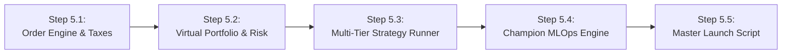

# Phase 5: Autonomous Paper Trading, Multi-Tier AI Execution & MLOps Governance
## Master Production Specification

---

## 1. Objectives & Scope

Phase 5 is the **Live Execution Core** of MarketIntel. It integrates all 5 verified AI models, streaming tick-to-candle data (from Phase 3), and rigorous risk governance into an **Autonomous Paper Trading Execution & Portfolio Management Engine**.

> [!IMPORTANT]
> **Live Mode Guarantee**: `EXECUTION_MODE="PAPER"`.
> Initial Virtual Account Balance: **₹10,00,000 INR**.
> Real-time order matching against live market ticks with 0.05% slippage and complete Indian statutory costs (STT, GST, SEBI fees, Exchange turnover, and Stamp duty). **Zero real money is at risk.**

---

## 2. Multi-Horizon Architecture & Conflict Resolution

To prevent time-horizon contamination, the system operates under a strict **Institutional Hierarchy**:

```mermaid
flowchart TD
    subgraph MACRO_GATE ["Tier 0: Long-Term Macro Gatekeeper (Model 2)"]
        M2["Model 2: Secular Quality & Compounding (1-Year Horizon)"]
        M2 -->|Structural Drawdown > -40% or Calmar Collapsed| BAN["PERMANENTLY BANNED from Portfolio (Trash Stock Filter)"]
        M2 -->|High Quality Compounder (Pristine Balance Sheet)| APPROVED["APPROVED UNIVERSE"]
    end

    subgraph TACTICAL_FUNNEL ["Tiers 1–3: Tactical Momentum & Timing (Models 0, 3, 4)"]
        APPROVED --> M0["Tier 1 (09:08 AM): Model 0 Pre-Market Screener (Top 4 to 20 Stocks)"]
        M0 --> M3["Tier 2 (09:15 AM): Model 3 Valuation Corridor Check (Must be P25 to P50)"]
        M3 --> M4["Tier 3 (09:30 AM): Model 4 Action & Confidence (STRONG_BUY with Conf >= 65%)"]
    end

    subgraph EXEC_RISK ["Tiers 4–5: Execution & Dynamic Risk (Models 3 & 1)"]
        M4 --> SIZING["Dynamic Volatility Sizing (Safe stocks get MORE money, volatile get LESS)"]
        SIZING --> TRIG["Tier 4: 1-Min Intraday Trigger (ORB 15m Breakout + VWAP + RVOL > 1.2)"]
        TRIG --> EXEC["ORDER FILLED"]
        EXEC --> SL["Stop-Loss: Model 3 P05 Floor (Capped at -6.0%)"]
        EXEC --> T1["Target 1 (Book 50%): Model 3 P75 Resistance"]
        EXEC --> T2["Target 2 (Runner): Trail via Model 1 Q90 Ceiling"]
    end
```

### The 3 Golden Conflict Resolution Rules:
1. **Never use a 1-year signal to manage a swing trade**:
   * An active swing trade is governed **exclusively by Model 4 and Model 3**.
   * If Model 4 flips to `SELL`, the swing position is exited immediately the next morning. We never hold through a short-term breakdown hoping the long-term trend will save it.
2. **Never use a 1-day noise dip to sell a secular compounder**:
   * Long-term wealth holdings (Model 2) ignore minor 1-day noise as long as their 3-year Sortino and 200 EMA remain intact.
3. **Never buy dead-cat bounces in structurally broken companies**:
   * Even if a stock prints a 1-day $+5\%$ breakout, if Model 2 classifies it as structurally impaired, it is **strictly barred from entering the portfolio**.

---

## 3. Dynamic Sizing & Market Breadth Rules

### A. Dynamic Focus Watchlist Sizing:
* **Strong Bull Trend (Nifty trending up, high market breadth)**: Model 0 outputs **15 to 20 focus candidates**.
* **Choppy / Rangebound Market (Mixed sectors, low volume)**: Model 0 filters aggressively to **4 to 6 elite candidates**.
* **Severe Market Crash (India VIX surging $>20\%$, global panic)**: Model 0 outputs **ZERO trades**. The system stays in **100% Cash** to preserve the ₹10 Lakhs capital.

### B. Dynamic Capital Allocation (Which stocks get MORE money vs. LESS money?):
$$\text{Position Capital (₹)} = \frac{\text{Fixed Account Risk (₹10,000)}}{\text{Distance to ML Stop \%}} \times \text{Confidence Factor}$$

* **Low-Beta High-Confidence Stock** (e.g. TCS / HDFC Bank with tight $-2.5\%$ stop, Conf $82\%$):
  * Allocated **₹80,000 to ₹1,00,000 (MORE MONEY)**. Total risk if stopped out: **₹2,250**.
* **High-Beta Volatile Runner** (e.g. Zomato / Suzlon with wide $-5.2\%$ stop, Conf $68\%$):
  * Allocated **₹35,000 to ₹40,000 (LESS MONEY)**. Total risk if stopped out: **₹2,080**.
* **Equalized Risk**: Every trade risks the exact same $\approx 0.2\%$ to $0.25\%$ of total portfolio capital.

---

## 4. Multi-Tier AI Execution Specifications

| Step | Trigger Time | Engine | Exact Condition |
| :--- | :---: | :---: | :--- |
| **1. Screener** | **09:08 AM** | **Model 0** | Top 4 to 20 cross-sectional ranker based on overnight global cues + momentum. |
| **2. Corridor Check** | **09:15–09:30 AM** | **Model 3** | Current price must be in **$P_{25} \rightarrow P_{50}$ Fair Value Zone**. Disqualify if $\ge P_{95}$ ceiling. |
| **3. Action Confirmation** | **09:30 AM** | **Model 4** | Must output **`STRONG_BUY`** or **`BUY`** with **Platt-scaled Confidence $\ge 65\%$**. |
| **4. Intraday Entry Trigger** | **Real-Time** | **Streaming Engine** | 1-minute bar: **15m ORB Breakout** + **Price > VWAP** + **$RVOL > 1.2$**. |
| **5. Stop-Loss** | **Post-Fill** | **Model 3** | Placed at **$P_{05}$ Crash Floor** (clamped by a hard safety cap of max $-6.0\%$). |
| **6. Target 1 (50% Profit)** | **Dynamic** | **Model 3** | Placed at **$P_{75}$ Resistance Band**. Sell 50%, move stop on remainder to Entry (Breakeven). |
| **7. Target 2 (Runner Exit)** | **Dynamic** | **Model 1** | Trailed using **$Q_{90}$ Momentum Ceiling** or 20 EMA. |
| **8. Invalidation Exit** | **03:30 PM EOD** | **Model 4** | Exit immediately if Model 4 flips to `SELL` on daily close. |

---

## 5. Realistic Execution Mechanics & Statutory Indian Frictions

Every simulated order accurately models live institutional trading costs:
1. **Slippage**: $0.05\%$ penalty on market order executions.
2. **STT (Securities Transaction Tax)**: $0.1\%$ on buy and sell delivery turnover ($0.2\%$ round-trip).
3. **Exchange Turnover Charges**: $0.00345\%$ on total turnover.
4. **SEBI Turnover Fee**: ₹10 per crore of turnover.
5. **Stamp Duty**: $0.015\%$ on buy side turnover.
6. **GST (Goods & Services Tax)**: $18\%$ on brokerage and exchange charges.

---

## 6. Implementation Deliverables (Phase 5 Roadmap)



* [ ] **Step 5.1: Virtual Order & Tax Calculation Engine (`src/execution/order_engine.py`)**
  * Realistic order matching engine with 0.05% slippage and complete Indian statutory tax deductions.
* [ ] **Step 5.2: Virtual Portfolio & Risk Manager (`src/execution/portfolio_manager.py`)**
  * ₹10,00,000 virtual capital ledger, position tracker, margin manager, and $-3.0\%$ daily circuit breaker.
* [ ] **Step 5.3: Multi-Tier AI Strategy Runner (`src/execution/strategy_runner.py`)**
  * Integrates Models 0, 3, 4, 1, and 2 into the automated live paper trading loop.
* [ ] **Step 5.4: Champion vs. Challenger MLOps Governance (`src/mlops/champion_governance.py`)**
  * Weekly Saturday 02:00 AM walk-forward tournament between Champion and retrained Challenger models.
* [ ] **Step 5.5: Single-Click Master Startup Script (`start_marketintel.bat` & `scripts/launch_system.py`)**
  * Master boot script that launches Redis/In-Memory bus, background workers, AI inference, and paper execution with 1 click.
