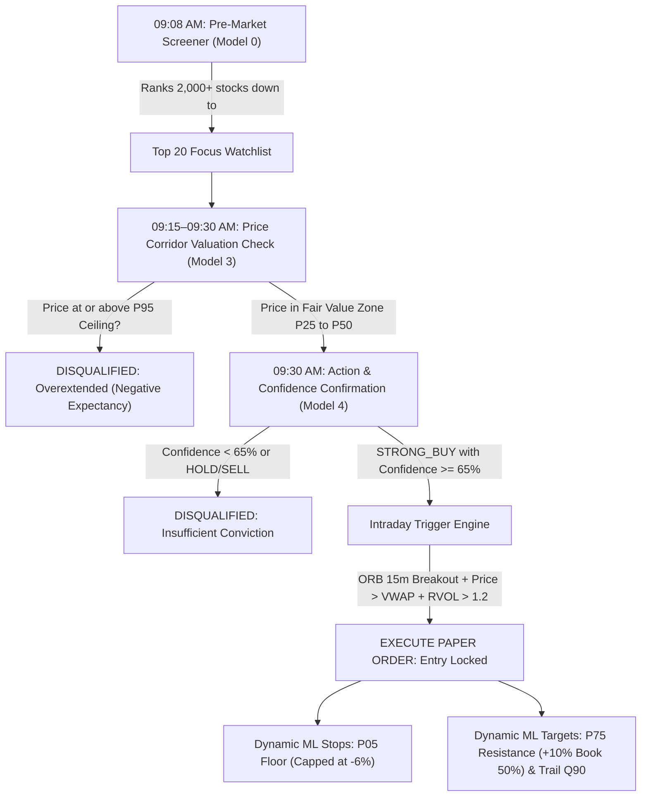

# Phase 5: Autonomous Paper Trading, Multi-Tier AI Execution & MLOps Governance

## 1. Objectives & Scope

Phase 5 bridges the verified AI models (from Phase 4) and streaming ingestion (from Phase 3) into an **Autonomous Paper Trading Execution & Portfolio Management System**.

### Core Pillars:
1. **Multi-Tier AI Execution Funnel**:
   * Combines Models 0, 3, 4, and 1 into a cohesive institutional entry pipeline.
   * Eliminates premature or bad entries — filters out stocks that have already overextended or lack institutional volume.
2. **ML-Driven Dynamic Risk Architecture**:
   * **Stops**: Dynamic calculation via **Model 3 $P_{05}$ Quantile Crash Floor**, clamped by a hard institutional risk ceiling (maximum -6.0%).
   * **Targets**: **Target 1** at **Model 3 $P_{75}$ Upper Resistance** (book 50% profit); **Target 2 (Runner)** trailed via **Model 1 $Q_{90}$ Momentum Envelope**.
   * **Position Sizing**: Mathematically sized to risk exactly 1% (₹10,000) of portfolio based on the distance between Entry Price and ML Stop Price.
3. **Institutional Execution Simulation**:
   * Simulated execution matching against real 1-minute and 5-minute ticks.
   * Realistic execution mechanics:
     * Bid-Ask slippage modeling (0.05% on market orders).
     * Complete Indian statutory costs: Securities Transaction Tax (STT), Exchange Turnover Charges, SEBI fees, Stamp Duty, and 18% GST.
4. **Virtual Portfolio & Risk Governance**:
   * Initial capital: **₹10,00,000 virtual INR** (Strictly paper trading; `EXECUTION_MODE="PAPER"`).
   * Maximum 5% capital per position (₹50,000).
   * Maximum 10 concurrent open positions.
   * Portfolio Circuit Breaker: Automated halt if cumulative daily drawdown touches **-3.0%**.
5. **Single-Click Master Startup Orchestrator (`start_marketintel.bat` & `scripts/launch_system.py`)**:
   * Boots the entire platform with 1 single click:
     1. Redis auto-detection (falls back to high-speed in-memory broker in <1ms).
     2. Pre-flight API and lakehouse integrity check.
     3. Active model registry verification from `models/active/`.
     4. Real-time tick & candle streaming service.
     5. Paper Trading Execution Engine & Portfolio Manager.
     6. Automated browser launch to the Terminal Dashboard.

---

## 2. Multi-Tier AI Execution Funnel Architecture



### Detailed Filter Specifications:
* **Tier 1 (Pre-Market 09:08 AM) — Model 0**:
  * Ingests overnight global assets (S&P 500, Nasdaq, Crude, USD/INR, 10Y Yield, India VIX, FII flows).
  * LambdaMART ranker outputs Top 20 actionable long candidates for the trading session.
* **Tier 2 (Market Open 09:15–09:30 AM) — Model 3 Corridor Filter**:
  * Evaluates current market price relative to Model 3's volatility cones.
  * Disqualifies stocks opening gap-up at $P_{95}$ exhaustion ceiling ($>2 \times ATR_{14}$ stretch).
  * Passes only stocks trading within the $P_{25} \rightarrow P_{50}$ value corridor.
* **Tier 3 (09:30 AM Confirmation) — Model 4 Action Classifier**:
  * Evaluates EMA stack (20 > 50 > 200), Wilder RSI, ADX, and RVOL.
  * Approves only stocks classified as **`STRONG_BUY`** or **`BUY`** with **Platt-scaled Confidence $\ge 65\%$**.
* **Tier 4 (Execution Trigger) — Intraday Real-Time Math**:
  * **Opening Range Breakout (ORB 15m)**: Price crosses above the high of the first 15-minute candle.
  * **VWAP Bias**: Current price must trade strictly above Volume-Weighted Average Price.
  * **Institutional Surge**: Relative volume ($RVOL_{20} > 1.2$).
* **Tier 5 (Position & Risk Sizing)**:
  * **Stop-Loss**: $\text{Stop Price} = \max(\text{Model 3 } P_{05} \text{ Floor},\; \text{Entry} \times 0.94)$.
  * **Quantity**: $\text{Shares} = \lfloor \frac{₹10,000}{\text{Entry} - \text{Stop Price}} \rfloor$, capped at ₹50,000 total capital.
  * **Target 1**: Model 3 $P_{75}$ upper resistance band (sell 50% shares, move stop to breakeven).
  * **Target 2**: Model 1 $Q_{90}$ momentum ceiling (trail remainder with 20 EMA).

---

## 3. Database & Ledger Schemas

### A. Persistent Paper Orders Table:
```sql
CREATE TABLE paper_orders (
    order_id UUID PRIMARY KEY,
    symbol VARCHAR(30) NOT NULL,
    direction VARCHAR(5) NOT NULL, -- BUY
    order_type VARCHAR(10) NOT NULL, -- MARKET, LIMIT, STOP_LOSS
    trigger_reason VARCHAR(50) NOT NULL, -- ORB_VWAP_BREAKOUT, P05_STOP_HIT, P75_TARGET_HIT
    requested_price REAL NOT NULL,
    filled_price REAL NOT NULL,
    slippage_pct REAL DEFAULT 0.05,
    quantity INT NOT NULL,
    order_time TIMESTAMPTZ NOT NULL,
    status VARCHAR(20) DEFAULT 'FILLED' -- FILLED, REJECTED, CANCELLED
);
```

### B. Persistent Paper Trade Positions & Journal:
```sql
CREATE TABLE paper_positions (
    trade_id UUID PRIMARY KEY,
    symbol VARCHAR(30) NOT NULL,
    entry_time TIMESTAMPTZ NOT NULL,
    entry_price REAL NOT NULL,
    quantity_initial INT NOT NULL,
    quantity_open INT NOT NULL,
    ml_stop_price REAL NOT NULL,      -- Model 3 P05 Floor
    ml_target_1 REAL NOT NULL,        -- Model 3 P75 Resistance
    ml_target_2 REAL,                 -- Model 1 Q90 Ceiling
    allocated_capital REAL NOT NULL,  -- Max ₹50,000
    risk_capital REAL NOT NULL,       -- Max ₹10,000
    current_market_price REAL NOT NULL,
    unrealized_pnl REAL NOT NULL,
    unrealized_pnl_pct REAL NOT NULL,
    status VARCHAR(20) DEFAULT 'OPEN' -- OPEN, PARTIAL_EXIT, CLOSED
);

CREATE TABLE paper_trade_ledger (
    trade_id UUID PRIMARY KEY,
    symbol VARCHAR(30) NOT NULL,
    entry_time TIMESTAMPTZ NOT NULL,
    entry_price REAL NOT NULL,
    exit_time TIMESTAMPTZ NOT NULL,
    exit_price REAL NOT NULL,
    quantity INT NOT NULL,
    holding_period_days INT NOT NULL,
    gross_pnl REAL NOT NULL,
    slippage_cost REAL NOT NULL,
    statutory_taxes REAL NOT NULL, -- STT + Exchange + SEBI + Stamp + GST
    net_pnl REAL NOT NULL,
    net_pnl_pct REAL NOT NULL,
    exit_trigger VARCHAR(50) NOT NULL -- TARGET_1, TRAILING_STOP, HARD_STOP, DAILY_HALT
);
```

---

## 4. Implementation Steps & Milestones

* [ ] **Step 5.1: Virtual Order & Tax Calculation Engine (`src/execution/order_engine.py`)**
  * Realistic order fills with 0.05% slippage simulation.
  * Vectorized statutory tax calculator (STT, Exchange turnover, SEBI, Stamp duty, GST).
* [ ] **Step 5.2: Virtual Portfolio & Risk Manager (`src/execution/portfolio_manager.py`)**
  * ₹10,00,000 capital tracker, margin manager, position book, and cash ledger.
  * 1% risk per trade formula and 5% max position allocation limits.
* [ ] **Step 5.3: Multi-Tier AI Strategy Runner (`src/execution/strategy_runner.py`)**
  * Integrates Model 0 Watchlist $\rightarrow$ Model 3 Corridor Filter $\rightarrow$ Model 4 Confidence Check $\rightarrow$ 1-minute VWAP/ORB Breakout Trigger.
  * Real-time position monitor for dynamic stop-loss adjustments and target profit-taking.
* [ ] **Step 5.4: Champion vs. Challenger MLOps Governance (`src/mlops/champion_governance.py`)**
  * Weekly Saturday evaluation gate between existing Champion and new Challenger retrained models.
* [ ] **Step 5.5: Single-Click Master Orchestrator (`start_marketintel.bat` & `scripts/launch_system.py`)**
  * Master boot script that starts Redis/In-Memory bus, background workers, AI inference, and paper execution with one click.
